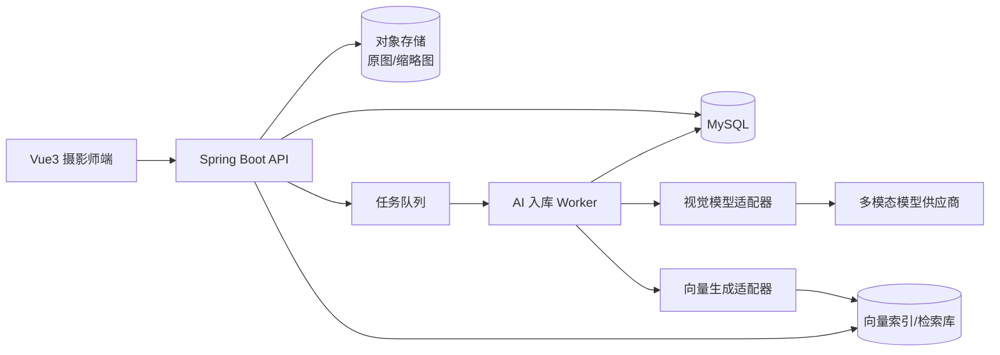
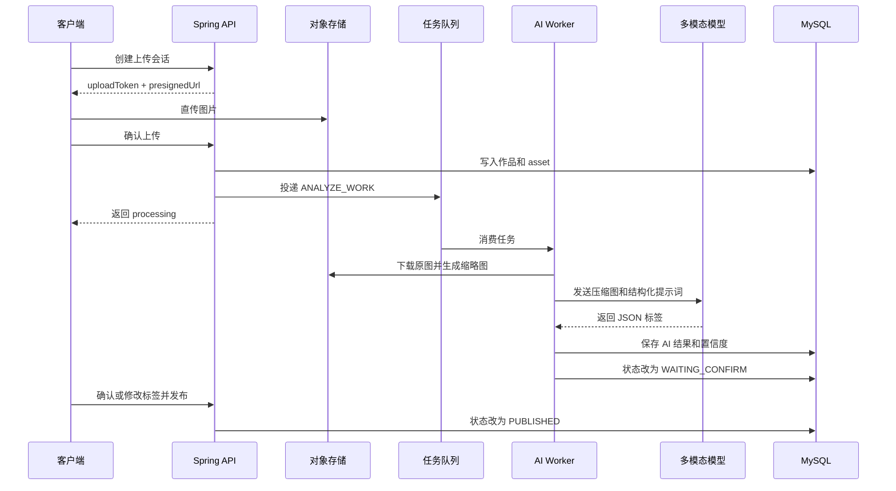

# AI-1 作品智能入库：架构与后端设计（v1.1）

## 1. 目标与边界

AI-1 负责把摄影师上传的图片变成可检索的作品资产。它为 AI-2「AI 筛作品」提供结构化标签、地点范围、作品向量和可展示的分析结果。

本期必须完成：

- 摄影师批量上传图片，支持单张和一组作品。
- 保存原图、缩略图和作品元数据。
- AI 自动识别地点线索、风格、服装类型、光线和画面主体。
- 摄影师在发布前确认或修改 AI 标签。
- 任务可重试、可查看失败原因，重复上传不会产生重复作品。
- 作品只有审核通过后，才进入公开作品库和 AI-2 检索索引。

本期不做：自动判断摄影师水平、自动定价、面部身份识别、版权归属裁决和生成式修图。

## 2. 总体架构



### 2.1 组件职责

| 组件 | 职责 | 推荐实现 |
|---|---|---|
| Spring Boot API | 登录校验、上传凭证、作品发布、任务查询 | Spring Web + Validation |
| MySQL | 作品、标签、任务、审核状态和操作记录 | MySQL 8 |
| 对象存储 | 原图、压缩图、缩略图 | S3 兼容存储，开发期可用 MinIO |
| 任务队列 | 解耦上传和 AI 分析，支持重试 | Redis Stream；若暂时不引入 Redis，可用数据库任务表轮询 |
| AI Worker | 图片预处理、调用模型、结果校验、写回数据库 | Spring Boot 独立进程或同项目异步模块 |
| 向量索引 | AI-2 的相似作品召回 | 开发期 MySQL JSON + 关键词，演示期可接 pgvector / Milvus |

模型和向量服务必须通过接口封装。业务代码不能直接依赖某一家模型厂商，便于比赛演示时切换真实模型、Mock 模型或本地模型。

### 2.2 优化后的执行边界

AI-1 不再是一个“上传后调用一次视觉模型”的黑盒，而是一条可恢复的流水线：

```text
上传确认 → PREPROCESS → SAFETY_CHECK → TAG → NORMALIZE → EMBED → INDEX
                 ↓             ↓          ↓
              可重试         可审计      用户确认
```

API 只创建作品和任务，不等待模型；Worker 逐阶段消费任务。每阶段使用 `task_id + stage + input_version` 幂等，失败只重试当前阶段。`NORMALIZE` 是模型与业务之间的防腐层：它负责 JSON Schema、标签字典、置信度阈值和地点确认规则，模型原文不能直接写入 `work_tags`。

## 3. 入库流程



### 3.1 状态机

`DRAFT → UPLOADING → PROCESSING → WAITING_CONFIRM → PUBLISHED`

异常分支：

- `PROCESSING → FAILED`：模型超时、图片损坏或结果不符合 JSON Schema。
- `FAILED → PROCESSING`：用户点击重试，最多自动重试 3 次。
- `WAITING_CONFIRM → DRAFT`：摄影师退回修改。
- `PUBLISHED → HIDDEN`：摄影师主动下架或收到合规处理结果。

只有 `PUBLISHED` 的作品允许出现在公开作品流、地点筛选和 AI-2 候选集中。

## 4. 领域模型与数据表

### 4.1 `works` 作品主表

| 字段 | 类型 | 说明 |
|---|---|---|
| id | bigint | 主键 |
| photographer_id | bigint | 摄影师用户 ID |
| title | varchar(120) | 作品标题，可由用户填写 |
| description | varchar(500) | 作品说明 |
| status | varchar(32) | 状态机状态 |
| visibility | varchar(16) | `PUBLIC`、`PRIVATE` |
| source_type | varchar(32) | `SELF_UPLOAD`、`COLD_START_IMPORT` |
| location_text | varchar(120) | 用户确认后的地点文本 |
| location_lat/lng | decimal | 可选坐标，不保存精确住址 |
| ai_version | varchar(40) | 本次分析使用的模型版本 |
| published_at | datetime | 发布时间 |
| created_at/updated_at | datetime | 审计时间 |

索引：`(status, visibility, published_at)`、`(photographer_id, created_at)`、`(location_text)`。

### 4.2 `work_assets` 文件资产表

保存文件本身和可重复处理所需的信息。

| 字段 | 类型 | 说明 |
|---|---|---|
| id | bigint | 主键 |
| work_id | bigint | 作品 ID |
| object_key | varchar(255) | 原图对象存储 Key |
| thumb_key | varchar(255) | 缩略图 Key |
| mime_type | varchar(80) | 仅允许 jpeg/png/webp |
| width/height | int | 图片尺寸 |
| file_size | bigint | 字节数 |
| sha256 | char(64) | 文件去重指纹 |
| perceptual_hash | varchar(64) | 近似图去重指纹 |
| sort_no | int | 组图顺序 |

唯一约束：`(photographer_id, sha256)`。同一摄影师重复上传同一文件时返回已有资产。

### 4.3 `work_ai_results` AI 原始结果表

| 字段 | 类型 | 说明 |
|---|---|---|
| id | bigint | 主键 |
| work_id | bigint | 作品 ID |
| task_id | bigint | 对应任务 |
| raw_json | json | 模型原始结构化结果 |
| normalized_json | json | 后端清洗后的结果 |
| model_name | varchar(80) | 模型名称 |
| model_version | varchar(40) | 模型版本 |
| prompt_version | varchar(40) | 提示词版本 |
| overall_confidence | decimal(5,4) | 总体置信度 |
| created_at | datetime | 生成时间 |

原始 JSON 只作为审计和重新归一化依据，前端读取 `normalized_json`。

### 4.4 `work_tags` 标签表

| 字段 | 类型 | 说明 |
|---|---|---|
| id | bigint | 主键 |
| work_id | bigint | 作品 ID |
| dimension | varchar(32) | `LOCATION`、`STYLE`、`CLOTHING`、`LIGHT`、`SUBJECT` |
| tag_code | varchar(64) | 稳定枚举编码 |
| tag_name | varchar(80) | 展示名称 |
| source | varchar(16) | `AI`、`USER` |
| confidence | decimal(5,4) | AI 置信度，用户标签为空 |
| is_confirmed | tinyint | 是否被用户确认 |

唯一约束：`(work_id, dimension, tag_code)`。

### 4.5 `ai_tasks` 任务表

| 字段 | 类型 | 说明 |
|---|---|---|
| id | bigint | 主键 |
| task_type | varchar(32) | `ANALYZE_WORK`、`GENERATE_EMBEDDING` |
| business_id | bigint | work_id |
| status | varchar(16) | `PENDING`、`RUNNING`、`SUCCESS`、`FAILED` |
| attempts | int | 已重试次数 |
| idempotency_key | varchar(120) | 幂等键 |
| error_code | varchar(64) | 可展示的错误码 |
| error_message | varchar(500) | 脱敏后的错误信息 |
| next_retry_at | datetime | 下次重试时间 |
| started_at/finished_at | datetime | 任务时间 |

唯一约束：`(task_type, idempotency_key)`。

建议补充字段：`stage`、`input_version`、`worker_id`、`lease_expire_at`、`provider`、`model_tier`、`prompt_version`、`fallback_reason`。若一个作品有多阶段任务，唯一键改为 `(business_id, stage, input_version)`，避免整条链路重复执行。

另建 `ai_run_steps` 保存每次阶段执行的耗时、输入哈希、输出 Schema 版本、token 用量、错误码和证据引用；原始响应只用于审计，不直接给前端。

## 5. 标签字典

AI 不能自由生成无限标签。模型输出先落到受控字典，未知词进入 `unmapped_terms`，由后端记录但不直接展示。

首版字典建议如下：

- 地点：西安、小寨、曲江、大雁塔、漫展场馆、室内棚拍、户外自然、用户自定义地点。
- 风格：日系清透、氛围感、电影感、赛博、复古、纪实、甜酷、国风、森系、情绪人像。
- 服装类型：Cosplay、JK、汉服、Lolita、日常、礼服、机能风、角色还原。
- 光线：自然光、硬光、柔光、逆光、侧光、夜景、闪光灯、低饱和。
- 主体：单人、双人、多人、半身、全身、特写、环境人像、风景。

地点标签分两层保存：`location_text` 保存用户确认文本，`LOCATION` 标签用于检索。AI 推断的地点必须标记为低置信度，不能当作已确认的拍摄地点。

## 6. AI 分析契约

### 6.1 模型输入

- 发送缩放后的分析图，最长边建议 1536 像素。
- 同时发送摄影师填写的地点、标题和备注，作为上下文，不让模型仅凭图片猜地点。
- 明确要求只返回 JSON，不输出 Markdown 和解释性文字。

### 6.2 固定输出 Schema

```json
{
  "location": {
    "candidates": [{"name": "小寨", "confidence": 0.62}],
    "needs_user_confirmation": true
  },
  "style": [
    {"code": "ATMOSPHERIC", "name": "氛围感", "confidence": 0.91}
  ],
  "clothing": [
    {"code": "COSPLAY", "name": "Cosplay", "confidence": 0.97}
  ],
  "light": [
    {"code": "BACKLIGHT", "name": "逆光", "confidence": 0.88}
  ],
  "subject": [
    {"code": "SINGLE_PERSON", "name": "单人", "confidence": 0.95}
  ],
  "quality_flags": {
    "is_blurry": false,
    "is_duplicate_like": false,
    "has_sensitive_content": false
  },
  "summary": "户外逆光下的单人 Cosplay 人像，整体偏氛围感。"
}
```

后端使用 JSON Schema 校验、枚举归一化和置信度截断。模型返回非法 JSON 时进入重试，不允许把原始文本直接写入标签表。

Schema 必须带版本号（如 `work-tag.v1`）和 `evidence` 字段。对地点建议额外返回 `place_id` 候选与依据类型（`USER_CONTEXT`、`IMAGE_HINT`、`MODEL_GUESS`）；没有用户上下文或可解释依据时，不得把地点升级为已确认地点。解析失败先做一次“修复 JSON”重试，仍失败则进入 `MANUAL_RETRY`，不要无限重试。

### 6.3 置信度策略

- `confidence >= 0.75`：作为 AI 建议标签展示。
- `0.50 - 0.74`：展示为“待确认”，不参与强匹配。
- `< 0.50`：仅保存在原始结果，不展示、不入检索索引。
- 地点不论置信度，都必须由摄影师确认后写入 `location_text`。

## 7. 后端接口

接口前缀：`/api/v1`，所有接口要求登录，资源归属按 `photographer_id` 校验。

### 7.1 创建上传会话

`POST /works/upload-sessions`

请求：

```json
{
  "count": 3,
  "sourceType": "SELF_UPLOAD"
}
```

响应：

```json
{
  "sessionId": "us_01J...",
  "items": [
    {"assetId": 1001, "uploadUrl": "https://...", "expiresIn": 900}
  ]
}
```

### 7.2 确认上传并创建作品

`POST /works/upload-sessions/{sessionId}/complete`

请求：

```json
{
  "assets": [
    {"assetId": 1001, "sha256": "...", "sortNo": 1}
  ],
  "title": "小寨漫展场照",
  "locationText": "西安小寨",
  "description": "自然光，单人角色还原"
}
```

响应返回 `workId` 和 `status=PROCESSING`。该接口必须使用 `Idempotency-Key`，重复请求返回同一个作品。

### 7.3 查询入库状态

`GET /works/{workId}/ingestion`

响应包含：

```json
{
  "workId": 2001,
  "status": "WAITING_CONFIRM",
  "progress": 100,
  "failedReason": null,
  "tags": {
    "style": [{"code": "ATMOSPHERIC", "name": "氛围感", "confidence": 0.91, "source": "AI"}],
    "clothing": [],
    "light": []
  },
  "location": {"text": "西安小寨", "confirmed": true}
}
```

### 7.4 修改 AI 标签

`PATCH /works/{workId}/tags`

请求传入完整的用户确认结果，后端采用替换式保存，避免删除标签失败导致脏数据。

```json
{
  "locationText": "西安小寨",
  "tags": [
    {"dimension": "STYLE", "tagCode": "ATMOSPHERIC"},
    {"dimension": "CLOTHING", "tagCode": "COSPLAY"},
    {"dimension": "LIGHT", "tagCode": "BACKLIGHT"}
  ]
}
```

### 7.5 发布作品

`POST /works/{workId}/publish`

发布前校验：至少一张有效图片、地点已确认、至少一个风格或服装标签、肖像授权勾选完成、作品状态为 `WAITING_CONFIRM` 或 `DRAFT`。

发布成功后投递 `GENERATE_EMBEDDING`，索引失败不回滚作品发布，只将 `indexStatus` 标为 `PENDING` 并重试。

### 7.6 重试 AI 任务

`POST /works/{workId}/ingestion/retry`

仅允许作品所有者调用，且任务处于 `FAILED`。服务端重新生成新的 `idempotency_key`，保留旧任务和错误记录。

## 8. Worker 实现要点

1. 消费任务后先抢占租约。使用 `status=RUNNING`、`worker_id` 和 `lease_expire_at` 避免重复执行；Redis Stream 用 Consumer Group，任务表作为最终事实源。
2. 下载图片后校验 MIME、大小和像素上限，拒绝伪造扩展名与超大图片。
3. 计算 SHA-256 和感知哈希，完成文件去重和近似重复提示。
4. 先执行图片安全检查，再调用风格分析模型。
5. 每个模型调用设置超时，建议连接 5 秒、读取 30 秒；设置单任务 token/费用上限和熔断，避免模型异常造成循环调用。
6. 结果按 Schema 校验并归一化后，在一个事务中写入 `work_ai_results`、`work_tags` 和作品状态。
7. 失败采用指数退避，例如 1 分钟、5 分钟、30 分钟。超过 3 次转人工可重试状态。
8. 记录模型名、版本、提示词版本、耗时、token 使用量、输入哈希和降级原因，便于比赛答辩展示 AI 链路，也支持后续按版本评估准确率。

Worker 还必须具备三道护栏：输入图片安全检查、输出 Schema/字典校验、最大重试与最大执行时长。生产环境禁止模型自行调用数据库或对象存储；它只能通过白名单适配器获得已经裁剪过的上下文。

伪代码：

```java
@Transactional
public void handleAnalyzeWork(Long taskId) {
    AiTask task = taskRepo.claim(taskId);
    Work work = workRepo.require(task.getBusinessId());
    ImageInput image = assetService.prepare(work);
    VisionResult result = visionAdapter.analyze(image, work.getContext());
    normalizedResultValidator.validate(result);
    tagService.replaceAiTags(work.getId(), tagNormalizer.normalize(result));
    aiResultRepo.save(AiResult.from(task, result));
    workRepo.markWaitingConfirm(work.getId());
    taskRepo.success(task.getId());
}
```

## 9. 冷启动作品导入

为满足“先灌入 cos 圈存量场照”的冷启动，管理员复用同一套上传接口，额外使用 `sourceType=COLD_START_IMPORT`。

- 导入人必须填写摄影师归属、来源说明、地点和肖像授权状态。
- 未确认授权的图片默认 `PRIVATE`，不能进入公开作品流。
- 管理员可批量上传，但每张图仍经过同样的 AI 分析和去重流程。
- 导入任务和摄影师自助上传任务使用相同表结构，避免后续维护两条链路。

## 10. 安全、合规与可观测性

- 原图只通过短时签名 URL 访问，前端不接触对象存储长期密钥。
- 图片上传限制为 20MB，允许格式为 JPEG、PNG、WebP。
- EXIF 默认清理，公开作品不暴露拍摄设备序列号和精确 GPS。
- 对可识别人脸的作品，发布时要求摄影师勾选已获授权，并支持下架。
- 模型日志不得记录原图 URL、用户手机号和完整提示词中的隐私字段。
- 指标至少包括任务成功率、平均耗时、重试率、模型 JSON 校验失败率和待确认转发布率。
- 增加阶段维度的 P50/P95、每模型成本、降级率、重复任务率、索引延迟和人工修改率；用 `traceId` 串起上传、Worker、模型和索引日志。
- 真实模型先以 5% 灰度运行，与 Mock/规则结果对比，异常时可按 `model_tier` 一键切回 Mock；不要把模型版本切换和数据库迁移绑定在同一次发布中。

## 11. 最小可交付顺序

1. `works`、`work_assets`、`work_tags`、`ai_tasks` 四张表和状态枚举。
2. 本地/MinIO 上传、缩略图生成、SHA-256 去重。
3. Mock Vision Adapter，返回固定 JSON，先跑通完整链路。
4. 摄影师确认标签和发布接口。
5. 接入真实多模态模型，保留 Mock 开关用于演示兜底。
6. 发布后生成向量或关键词索引，为 AI-2 提供查询接口。

## 12. AI-2 的最小查询接口预留

`POST /works/search`

```json
{
  "locationText": "周六下午小寨",
  "styleTags": ["ATMOSPHERIC", "COSPLAY"],
  "lightTags": ["BACKLIGHT"],
  "page": 1,
  "size": 20
}
```

返回作品卡片、摄影师信息、匹配标签和匹配原因。AI-1 只负责把可信数据准备好，排序和自然语言需求解析属于 AI-2。

AI-2 应复用后端的 `SearchQuery`、`ModelRouter`、`ai_runs` 和降级协议：先规则召回，再按需调用重排模型；检索结果必须携带作品/标签证据，模型只能解释和排序，不能扩大召回范围。

