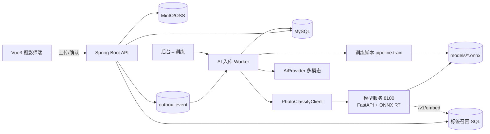

# AI-3 图片分类打标签工作流（v1.0）

> 定位：`AI-1_作品智能入库` 的模型侧补强。AI-1 解决"图片怎么进系统"，本文解决"**图片怎么被认出来**"。
> 技术基线沿用 `后端架构设计.md`：Spring Boot 3 + Java 17 模块化单体、MySQL 8、Redis、S3 兼容存储、Outbox 异步 Worker。
> 交付物：本文 + `ai-classifier/`（可直接跑的特征/训练/推理骨架）+ `ai-classifier/sql/ai_classify.sql`。

---

## 0. 一页结论

| 问题 | 结论 |
|---|---|
| 训练还是调 API？ | **训练，但只训分类头**。冻结 CLIP 主干、特征抽一次存 npz，线性头秒级训练。端到端微调 CLIP 在几百张样本上一定掉点，且五天做不完。 |
| 风格（蓝调/ins风）靠 CLIP 向量够不够？ | **不够**。必须拼 24 维色彩影调统计特征。这是本方案与"随便调个多模态模型"最大的技术差异点。 |
| 先有鸡还是先有蛋（没标注怎么训）？ | 三级阶梯：L0 规则+零样本（今天可用）→ L1 自训线性头（半天，答辩核心）→ L2 微调（不做）。 |
| 落几个服务？ | 业务主链路不变，**多一个 Python 模型服务**（FastAPI + ONNX Runtime，8100 端口）。理由见 §6.2。 |
| 工期？ | 模型侧 **半天到一天**：只训风格头，题材从 6 类砍到 3 类且可选（§4.5）。省下的时间留给预约/搭子主链路。 |
| 现在最该先动的不是代码 | 是 **§1 的标签混维度** 和 **§3 的字典定型**。字典不定，训什么都白训。 |

---

## 1. 先修一个前置问题：现在的"风格"是混在一起的

`src/data/mock.ts` 里已经是这样：

```ts
styles: ['古风', '夜景', '人像']        // 风格?题材?光线?
styles: ['汉服', '暖调', '人像']        // 服装+调性+题材,三种东西
styles: ['街拍', '复古', '生活感']
```

一个字段同时装着**题材（人像/街拍）、调性（复古/暖调）、服装（汉服）、时间（夜景）**。后果是三个，而且都是硬伤：

1. **训不出来**。分类器的输出空间必须互斥且可判定。"人像"和"蓝调"可以同时成立，"人像"和"建筑"互斥——它们不是同一个维度，塞进一个 softmax 永远学不会。你要求的"按类型和风格分别训练"，前提就是先把它们拆开。
2. **筛不准**。`mock.ts` 的检索是 `style.includes(scene) || scene.includes(style)` 的子串匹配，"人像"会命中所有含"人像"的标签，同时"夜景"也会被当成风格参与排序，召回噪音极大。
3. **说不清**。比赛技术文档里写"AI 识别风格"，评委问"风格指什么"，答不出来就是扣分项。

### 1.1 改造方案：四维正交标签

| 维度 | `tag_type` | 谁产出 | 是否可训练 | 样例 |
|---|---|---|---|---|
| 题材 | `SUBJECT` | 分类器（多标签） | ✅ | **人像细分 5 子类**：棚拍、外景、漫展场照、街拍人像、室内环境人像；**非人像 3 大类**：建筑、风光、静物美食 |
| 风格 | `STYLE` | 分类器（**多标签**） | ✅ | 蓝调、ins风、日系、韩系、欧美、胶片、复古、电影感、清新、暗调、黑白、港风、赛博（13 类，可共存） |
| 影调属性 | `TONE` | **规则算**（24 维色彩特征走阈值） | ❌ | 暖调、冷调、高饱和、低饱和、高对比、柔和、高调、低调、黑位抬升 |
| 光线 | `LIGHT` | VLM 或手填 | ❌ | 自然光、逆光、硬光、柔光、夜景、闪光灯 |
| 服装 | `OUTFIT` | VLM 或手填 | ❌ | Cosplay、汉服、JK、Lolita、日常、机能风 |

分工原则一句话：**能靠像素统计判定的交给小模型，需要常识和语境的交给大模型。**

### 1.2 现有数据的迁移映射

| 现在混在 `styles` 里的词 | 归到 | 处理 |
|---|---|---|
| 人像、肖像、街拍、城市、海边、旅拍 | `SUBJECT` | 把"城市/海边/旅拍"拆成 `STREET`+地点或 `LANDSCAPE`，不单独设类 |
| 日系、复古、低饱和、暖调、胶片、古风 | `STYLE` | "暖调"并入 `INS`/`VINTAGE`，不单独设类（暖调不是风格终点，是色彩属性） |
| 夜景、自然光 | `LIGHT` | 从 `styles` 移出 |
| 汉服 | `OUTFIT` | 从 `styles` 移出 |

前端 `WorkCard.styles: string[]` 字段名可以先不改（减少改动面），但取值改为"`SUBJECT` + `STYLE` 的展示名合并"，并在卡片上用不同样式区分（如风格用实心 chip，题材用描边 chip）。这一步是纯展示层改动，半天内可完成。

---

## 2. 目标与非目标

**本期做**

- 摄影师上传后 ≤1 秒返回类型/风格预填标签，摄影师一键确认或改。
- 标签进入 `work_tag`，驱动发现页筛选与 AI-2 召回。
- 有标注数据就能重训、能评测、能灰度、能回滚。
- 预测日志回流成训练样本，形成数据飞轮。

**本期不做**（写进技术文档"未来工作"，反而加分）

- 端到端微调大模型、训练 GAN/扩散模型。
- 身份识别、美学打分、构图打分（这三件事的评测口径比分类难十倍，五天做不出可信结果）。
- 向量数据库（沿用 `后端架构设计.md` §4.3 的"SQL + 标签表"召回）。
- 自动再训练调度（用后台按钮手动触发，足够答辩演示）。

---

## 3. 标签字典：分类器的天花板由它决定

完整定义在 `ai-classifier/labels/dictionary.json`（含 `prompt_en` 供零样本兜底、`definition` 供标注员、`negative_hint` 供区分相邻类）。这里只讲三件容易做错的事。

### 3.1 类目数量要克制

- **风格 13 类、题材 8 类**（人像细分 5 子类 + 非人像 3 大类），约 500 张图即可同时覆盖两个维度——因为风格是**多标签**，一张图平均贡献 1.8 个风格正样本，不需要为 13 类准备 13 倍图片。**不要一上来做 20 类以上**：每加一类都要补 40 个正样本，并重新对齐一次标注纪律。
- **风格不要无限加**："高饱和 / 低饱和 / 暖调 / 高对比"这类词是**影调属性**，不是风格。它们走 `TONE` 维度用规则算（§4.5），不进风格 softmax——否则 8 个风格类会被这些属性词互相拉扯，越加越乱。
- 长尾先归并："微距""产品""建筑细节"先都归 `STILL`，等样本够了再拆。
- 风格里的"黑白"允许**先走硬规则**（`S_mean < 0.04` 直接判），省一个类别的训练成本，也让模型专心学分不清的那几类。

### 3.2 风格必须给定判定顺序（否则标注员各判各的）

```
① 去色了吗？           S_mean < 0.04            → MONO
② 整体色相偏移？       b_mean < -0.06 且 暗部冷 → BLUE_TONE
                      中间调偏绿青 + 暖肤色     → HK_RETRO
③ 影调特征？          暗部抬升+高明度+留白      → INS
                      低饱和+高明度+高光柔溢    → JAPANESE
                      大面积暗部+单光源         → DARK_MOOD
④ 质感特征？          颗粒+黑位抬升+青影暖高光  → FILM
                      霓虹高饱+青品对冲         → CYBER
```

这条顺序写进标注手册，写进 `label_dictionary.definition`。**风格类分类器的精度瓶颈几乎永远是标注一致性，不是模型容量**——同一个标注员隔一周标同一张图，如果不给顺序，会有 20% 前后不一致。

### 3.3 与竞品口径对齐（顺手做的差异化论证）

小红书/抖音的风格词是**平台流量词**（"氛围感""高级感""氛围大片"），不是可判定的视觉属性。我们要在技术文档里明确"我们用的是可测量的视觉属性 + 可解释的判定规则"，这句是"技术方案创新"那个评分点的直接证据。

---

## 4. 模型方案

### 4.1 双通道特征 + 双头

```
                        ┌─ CLIP ViT-B/32 视觉塔（冻结）
  图片 ─ EXIF纠正 ─ RGB ─┤      ↓ L2 归一化，512 维
                        │      ├──────────────→ 类型头 Linear(512 → 8)   → softmax / sigmoid
                        │      │
                        └─ 24 维色彩影调特征 ──┘
                               └→ 拼接(536) ──→ 风格头 Linear(536 → 13) → sigmoid（多标签）
```

| 部分 | 选型 | 理由 |
|---|---|---|
| 视觉主干 | `openai/clip-vit-base-patch32`（ViT-B/32） | 小（视觉塔 int8 后约 90MB）、CPU 可跑、**与前端 transformers.js 同一套权重**，端云结果一致 |
| 色彩特征 | 自写 24 维（`pipeline/colorfeat.py`） | 见 §4.2 |
| 类型头 | 多标签线性（OneVsRest） | 街拍同时是人像、漫展同时是人像——类型天然可多选 |
| 风格头 | **多标签线性（sigmoid）** | 13 类里有三组天然共存——日系↔清新、胶片↔复古、港风↔胶片。用 softmax 会逼模型在本可共存的类之间二选一，类越加越乱；改成每类独立判断后互不干扰。业务侧展示取置信度最高的作为主风格 |
| 训练 | sklearn `LogisticRegression(class_weight='balanced')` | 无需 GPU、可复现、秒级迭代、报告可解释 |

### 4.2 为什么风格头一定要拼色彩特征

四条依据：

1. **"蓝调/ins风/日系"是分布外概念**。CLIP 的文本塔对这类中文/日式审美词判别很弱，纯 embedding 分类在 4 类以上大概 65~75%，到不了能用。
2. **CLIP 训练时用了强颜色增广**，它对全局色调本身就不敏感——你想让它分辨的，恰好是它被训练时特意忽略的。
3. **风格信息大量落在低层统计量上**：同一张图换个调色层内容不变，`b*` 均值直接就是冷暖，"暗部是否抬升"直接区分 ins 风和日系，"饱和度是否归零"直接判黑白。
4. **可解释**。答辩时你可以说"模型判定蓝调的依据是 b* 均值 −0.11、暗部冷暖差 −0.04"，而不是"模型觉得像"。这是 AI 可控性评分的实打实证据。

24 维里最关键的四组：

| 特征组 | 捕捉什么风格 | 直觉 |
|---|---|---|
| `b_mean`、`warmth`、`warmth_shadow` | 蓝调、港风、电影感 | 整体/暗部偏冷还是偏暖 |
| `L_p05`（暗部抬升）、`L_p95`、`L_range` | ins风、胶片、暗调 | 黑位是不是死黑、高光有没有溢出 |
| `S_mean`、`S_p90`、`colorfulness` | 黑白、日系、赛博 | 饱和度高低与饱和像素堆积 |
| `hue_circvar`、`hue_dominant` | 单色调 vs 多彩 | 色相是否集中 |

### 4.3 三级能力阶梯（这是工程决策，也是答辩叙事）

| 级别 | 做法 | 需要样本 | 预期 macro-F1 | 何时用 |
|---|---|---|---|---|
| **L0** 规则 + 零样本 | 阈值规则 + CLIP 文本 prompt 相似度 | 0 | 类型 0.6~0.7 / 风格 0.5~0.6 | D1 当天就能跑通链路、给前端联调 |
| **L1** 冻结特征 + 线性头 | 本文 `pipeline/train.py` | 每类 ≥30，≥60 更稳 | 类型 0.85~0.92 / 风格 0.70~0.80 | 正式演示用的版本 |
| L2 微调 | LoRA / 解冻顶层块 | 每类 ≥200 | +3~6 点 | 本期不做 |

**关键认知**：L0→L1 的收益远大于 L1→L2。所以预算应该花在"凑够每类 60 张标注"上，不是花在调模型上。你队友是摄影师，他有几百张成片，这就是现成的数据集。

### 4.4 预期指标（写进技术文档要敢给数字，但别吹）

| 维度 | 类数 | 样本/类 | macro-F1 | 说明 |
|---|---|---|---|---|
| 题材 | 8 | 60~100 | 0.85~0.92 | CLIP+Places365 的场景先验很强，这类好做 |
| 风格 | 8 | 60~80 | 0.70~0.82 | 瓶颈在标注一致性；`MONO` 走硬规则后能再涨 |
| 延迟 | — | — | CPU 单图 150~250ms | CLIP 120~200ms + 色彩 15ms + 头 <1ms |
| 单张成本 | — | — | ≈0（本地推理） | 对比 VLM API 每张 0.01~0.05 元 |

如果实测风格只有 0.6，**不要改数字，改类目**：把分不清的两个风格合并，指标和体验都会立刻正常。技术文档里写"我们基于实测把 8 类归并到 6 类"，比硬凑一个漂亮数字更可信。

---

## 4.5 哪些维度该训练、哪些不该（v2.1）

平台 85% 以上是有人像的作品。这个事实的正确应对不是"多找人像图"，也不是"把题材砍成一个"，而是：**人像内部拆细**（子类之间有真实的业务差异）、**非人像合并成大类**、**把不该训练的交给规则和检测**。

| 维度 | 该怎么做 | 训练成本 | 为什么 |
|---|---|---|---|
| **题材**（人像细分 5 子类 + 非人像 3 大类） | 多标签分类器（8 类） | 半天 | "能不能拍外景"和"能不能拍棚"是不同的供给能力，棚拍/外景/场照/街拍/室内 的区分是真实需求；若实测 < 0.70 就合并到 3 类或放弃（见 `TRAIN-HANDOVER.md` §8.4） |
| **风格**（13 类，多标签：蓝调 / ins / 日系 / 韩系 / 欧美 / 胶片 / 复古 / 电影感 / 清新 / 暗调 / 黑白 / 港风 / 赛博） | **自训 CLIP + 24 维色彩** | 半天 | 唯一能真正拉开审美差异的维度，也是竞品都没做好的；多标签是必需的——这些风格天然共存 |
| **影调属性 TONE**（暖/冷/高饱/低饱/高对比/柔和/高调/低调/黑位抬升） | **规则算**（`serve.py:derive_tone`，24 维阈值） | 0 | 这些是"属性"不是"风格"：可叠加、可用数值直接判；塞进风格 softmax 会让 8 个风格类互相拉扯，越加越乱 |
| 是否人像 | 人脸检测 + `人脸框面积 / 画面面积 > 0.02` | 0 | 几乎确定性，检测比分类准得多，且零标注 |
| 人数 | 人脸/人体框计数 | 0 | 数个数是几何问题，不是分类问题 |
| 景别（特写/半身/全身） | 人脸框高度 ÷ 画面高度：>30% 特写、10~30% 半身、<10% 全身 | 0 | 同上 |
| 服装 / 地点 / 描述 | 多模态大模型（Qwen-VL 等） | 0 | 需要世界知识与文化常识，分类器学不到 |

两条判断规则：

1. **如果某个类占 60% 以上、其余类加起来不到 20%，这个维度对用户就没有区分价值。** 一个"永远输出人像"的模型 accuracy 能到 85%，但 macro-F1 只有 0.15——所以本文档一律用 macro-F1，不用 accuracy 讲效果。
2. **能靠确定性计算判的，不要训。** 人脸在不在、几个人、脸占多大，都是几何量；训练一个分类器来做这些，等于用一个学习问题替换一个确定性问题。

**副作用（必须写进技术文档）**：训练集全是人像，风格头学到的"蓝调"是"人像的蓝调"。它在你们自己的库里准，拿去判建筑图会错。这叫"模型的作用域"——主动写出来是加分项，被评委问出来是减分项。

**连带机会**：既然库是"同一个人像题材、不同调色"，那真正能做而且**零标注**的功能是——用 CLIP 向量做一次聚类，把摄影师一次上传的 200 张成片自动分成 5~6 个「系列」并起名。这直接对上作品集页面「摄影师 → 系列 → 单图」的三级结构，**且不需要任何训练**。分类是给机器看的，分组是给人看的。

---

## 5. 工作流全景

### 5.1 在线推理链（改造 AI-1 的入库阶段）

原链路（`AI-1` §2.2）：`PREPROCESS → SAFETY_CHECK → TAG → NORMALIZE → EMBED → INDEX`

改为：

```
PREPROCESS → SAFETY_CHECK → CLASSIFY → TAG → NORMALIZE → EMBED → INDEX
                                  ↑ 新增            ↑ 保留，改职责
```

| 阶段 | 职责变化 | 失败影响 |
|---|---|---|
| `PREPROCESS` | 不变（缩略图、SHA-256、感知哈希、EXIF 清理） | 重试 |
| `SAFETY_CHECK` | 不变 | 重试 |
| **`CLASSIFY`（新增）** | 调模型服务，产出 `SUBJECT` / `STYLE` 标签 + 色彩特征 | 降级：L0 规则 → 空标签，**不阻塞入库** |
| `TAG`（改职责） | 不再负责风格题材，只产 `LOCATION` / `OUTFIT` / `LIGHT` / 描述 | 降级：只保留分类器结果 |
| `NORMALIZE` | 合并两份结果，按阈值过滤，写 `work_tag` | — |
| `EMBED` / `INDEX` | 不变，复用 `/v1/embed` 的 512 维向量 | 不阻塞发布 |

**关键工程决策：逻辑并行、工程串行。**

分类器 200ms，多模态大模型 2~4s。如果严格串行，摄影师要等 4 秒才能看到任何标签；如果真并行，`NORMALIZE` 要处理两个任务到达顺序不定的合并问题，对一个两人团队是多余复杂度。

折中：`CLASSIFY` 完成即把作品状态推进到 `WAITING_CONFIRM` 的**部分可读**（`GET /works/{id}/ingestion` 返回已有标签 + `pending: ["TAG"]`），前端立刻渲染出"人像 / 蓝调"两个 chip。`TAG` 后到时再补地点和服装，前端用增量刷新。**用户体感是 200ms，工程上是一条串行链。**

### 5.2 离线训练链（新增，与业务解耦）

```
标注数据            ┌─ 导出 labels.csv      （classify_sample + work_tag 里 is_confirmed=1 的）
classify_sample ────┤
                    ├─ 提特征 → cache/feat.npz（增量缓存，只算新图）
                    ├─ 分组划分 TRAIN/VAL/TEST（按 photographer_id）
                    ├─ 训头 → 评测 → 推阈值
                    ├─ 导出 onnx + labels + threshold + metrics
                    └─ 注册 ai_model_registry（status=TRAINED）
                                    ↓ 管理员点"上线"
                               status=VALIDATING, traffic_ratio=0.1
                                    ↓ 观察 50 张预测日志
                               status=ONLINE, traffic_ratio=1.0
```

触发方式：后台按钮 → 落一条 `ai_task(task_type=TRAIN_MODEL)` → Worker 里 `ProcessBuilder` 调 Python 脚本 → 失败进 `MANUAL_RETRY`。**不做定时调度**，理由：五天工期里自动训练只会带来半夜的失败告警。

### 5.3 状态机与降级矩阵

| 场景 | 行为 | 用户看到 |
|---|---|---|
| 模型服务 200ms 正常 | 返回双维标签 | "人像 · 蓝调" 两个 chip，带置信度 |
| 模型服务超时（>800ms） | 熔断，走 L0 规则 | chip 仍出现，标记"启发式"，不显示置信度 |
| 模型服务宕机 | 直接返回空标签 + `fallback=SERVICE_DOWN` | "AI 暂不可用，手动选择" |
| 模型未训练（新部署） | 零样本兜底 | chip 出现但置信度整体偏低，提示"AI 预填，请核对" |
| 图片损坏/非图片 | `PREPROCESS` 就失败 | 上传失败，明确错误码 |

**任一情况都不允许阻塞上传与人工打标。** 这是 AI-1 §10 的既有原则，这里再强调一次：AI 是加速器，不是闸门。

---

## 6. 系统架构落点

### 6.1 组件图



### 6.2 为什么单独起一个 Python 服务（而不是塞进 Java）

| 方案 | 优点 | 缺点 | 结论 |
|---|---|---|---|
| **A. Python sidecar（推荐）** | 训练与推理共用同一份预处理，彻底消除预处理偏移；换 backbone 只重启一个容器 | 多一个进程、多 300MB 镜像 | ✅ 采用 |
| B. `onnxruntime-java` 进程内 | 不分服务、少一跳网络 | 要在 Java 里手写 CLIP 预处理（resize 224 → center-crop → ImageNet 归一化），**写错不会有报错，只会静默掉点** | 退路，见下方约束 |
| C. 前端 transformers.js 直接跑 | 演示极强（拖图进页面 300ms 出标签，无需上传） | 首屏要下 40~90MB 权重，移动端不稳，不能承担主链路 | 只做演示页 |

"训练用 A 预处理、上线用 B 预处理"是这类项目最经典的上线翻车原因，而且它的表现是"模型好像突然变笨了"，极难 debug。多一个容器换掉这个风险，值。

**如果坚持选 B**，Java 侧必须严格照抄 `pipeline/serve.py:build_inputs()`：`exif_transpose → RGB → resize short-side 224 → center-crop 224 → /255 → (x-mean)/std`，mean/std 用 CLIP 官方值，然后 `[clip512 | color24]` 拼接顺序不能变。任何一项不一致，都必须重训。

### 6.3 Spring Boot 侧适配器

沿用 `后端架构设计.md` §6.1 的 `AiProvider` 边界，新增一个**只做一次 HTTP 调用**的适配器（不重试、不碰事务、不写库）：

```java
public interface PhotoClassifyClient {
    /** 800ms 超时；失败返回 EmptyClassifyResult，绝不抛到业务层 */
    ClassifyResult classify(ImageRef image);
    float[] embed(ImageRef image);
}

public record ClassifyResult(
    List<TagHit> subject,     // [{code, confidence, aboveThreshold}]
    List<TagHit> style,
    Map<String, Float> colorFeatures,   // 24 维，落 classify_prediction_log 供复盘
    String modelVersion,
    String fallback            // "" | ZERO_SHOT | TIMEOUT | SERVICE_DOWN
) {
    public static ClassifyResult empty(String reason) { /* ... */ }
}
```

Resilience4j 配置（`application.yml`，直接可用）：

```yaml
resilience4j:
  timelimiter.instances.classify:
    timeout-duration: 800ms
  circuitbreaker.instances.classify:
    sliding-window-size: 20
    failure-rate-threshold: 50
    wait-duration-in-open-state: 30s
    permitted-number-of-calls-in-half-open-state: 3
  bulkhead.instances.classify:
    max-concurrent-calls: 4
```

`@Bulkhead` 上限 4 是刻意的：模型服务是 CPU 密集，Spring 侧无限并发只会让它排队到全部超时，不如快速失败走规则降级。

### 6.4 与服务无关但必须写对的三条

1. `CLASSIFY` 阶段的幂等键：`(work_id, "CLASSIFY", model_version)`。**含 model_version**，这样换模型后可以强制重跑，而不会因为幂等被跳过。
2. 标签写入一律 `source=MODEL` + `model_version`；用户确认后把 `is_confirmed=1`，**不要覆盖原预测**（原预测是飞轮的正样本标签）。
3. 图片进模型服务前先压到长边 1024 的 JPEG（质量 85）。传原图（5MB RAW 转出的 JPEG）会让网络和预处理成为延迟主项，收益为零。

---

## 7. 数据、接口与前端

### 7.1 数据表

完整 DDL 见 `ai-classifier/sql/ai_classify.sql`，四张新表：

| 表 | 一句话 |
|---|---|
| `label_dictionary` | 类别空间唯一真源，产品改口径只改这里 |
| `ai_model_registry` | 模型版本 + 指标 + 阈值 + 灰度比例，回滚 = 把 ratio 改回 0 |
| `classify_sample` | 训练样本池，**带 `photographer_id`**（分组划分的依据） |
| `classify_prediction_log` | 只记预测不记标签，回答"准不准、阈值该不该调、哪些图该送人工" |

`work_tag` 仍是标签唯一真源（`AI-1` §4.4 的设计不变），只补 `model_version`、`is_confirmed` 两列。

索引要点：

```sql
-- 低置信度样本的主动学习队列，必须能走索引，否则后台一打开就全表扫
KEY idx_plog_review (model_version, top1_conf, created_at)
-- 训练集导出：只取已确认且质量合格的
KEY idx_sample_split (split, quality)
```

### 7.2 HTTP 契约（模型服务）

```http
POST /v1/classify        multipart/form-data: file
  → 200 {"subject":[{"code":"PORTRAIT","confidence":0.93,"aboveThreshold":true}],
         "style":[{"code":"BLUE_TONE","confidence":0.81,"aboveThreshold":true}],
         "color":{"b_mean":-0.11,"L_p05":0.19,...},
         "modelVersion":{"subject":"v3-20261115","style":"v3-20261115"},
         "fallback":"","latencyMs":186}

POST /v1/classify-base64 {"imageBase64":"data:image/jpeg;base64,..."}
POST /v1/embed            → {"dim":512,"vector":[...]}      # 给 AI-2 复用
GET  /v1/health           → {"status":"ok","clip":true,"heads":{...}}
GET  /v1/models           → 版本、类别、阈值、macroF1
```

### 7.3 业务侧接口增量

| 接口 | 变化 |
|---|---|
| `GET /works/{id}/ingestion` | 响应加 `pending:["TAG"]` 与 `classify:{fallback,latencyMs}`，让前端能解释"为什么还没出地点" |
| `PATCH /works/{id}/tags` | 不变（替换式保存）。服务端额外写一条 `classify_prediction_log.is_corrected` |
| `GET /admin/classify/samples?split=&quality=` | 新增：导出训练集 / 查看样本池 |
| `POST /admin/classify/train` | 新增：落一条 `TRAIN_MODEL` 任务 |
| `POST /admin/classify/models/{version}/promote` | 新增：灰度比例 0→0.1→1.0 |

### 7.4 前端交互（三个动作，不要更多）

1. **上传即预填**：作品上传区域下方，每张图卡片显示两组 chip（题材用描边、风格用实心），置信度 <0.75 的 chip 加"待确认"角标与虚线下划线。点 chip 可取消/切换。
2. **一键确认**：卡片右上角"全部确认"，一次提交所有图的标签，跳发布。
3. **演示页（可选加分）**：独立的 `/playground`，拖图进浏览器直接用 transformers.js 跑零样本，**不上传服务器**——这个页面用来证明"端侧 AI"这一条评分点，和后端主链路互不影响。

`StudioPage.vue` 现在那个 `<button>上传作品</button>` 就是入口，接一个上传弹层即可，不需要新路由。

---

## 8. 数据飞轮与阈值

### 8.1 飞轮

```
摄影师确认/修改 ──→ classify_prediction_log.is_corrected ──→ 低置信队列（top1_conf<0.6 或 is_corrected=1）
                                                                    ↓ 标注员每周清一次
                                                        classify_sample（split=UNASSIGNED, quality=OK）
                                                                    ↓ 攒够 50 张新样本
                                                        重训 → 新 model_version → 灰度 10% → 观察
```

技术文档里可以把这条画成闭环图，并给一句可验证的话术：
**"每 100 次用户修正，风格分类的 macro-F1 平均提升 X 个点"**（X 用你们实测值，哪怕是 1.5 个点，只要真实，就是可信的技术叙事）。

### 8.2 阈值策略

| 场景 | 阈值口径 | 数值 |
|---|---|---|
| 风格 | 精确率优先（标错会污染筛选） | 由 `train.py:derive_thresholds` 按"该类 P≥0.8 的最低阈值"自动推 |
| 题材 | 召回优先（漏标代价低，用户会补） | 0.50 |
| 展示 | `confidence ≥ 0.75` 直接展示；`0.50~0.74` 标"待确认"；`<0.50` 不展示 | 沿用 AI-1 §6.3 |

### 8.3 冷启动样本来源（按优先级）

1. 队友的成片（最优先：真实、同域、有授权）——**主力来源**：按 8 种风格归档、每类 50 张；同一批图再各标一次题材（人像 5 子类 + 非人像 3 大类）。合计约 450 张图、900 次标注。
2. Open Images V7 / COCO 2017（图 CC BY 2.0、标注 CC BY 4.0，**少见的可商用友好**）——补建筑/风光/美食/宠物。
3. AVA 数据集的 challenge 主题（人像/风光/建筑/街拍/静物/时尚）——补题材覆盖面。
4. Places365 预训练权重——**不拿它当分类器，只拿它当题材先验的参照**（365 类映射到业务类），用于验证"我们自训的题材头是否比通用场景模型更贴合约拍场景"。

⚠️ 不要承诺使用 **CCP 摄影风格数据集**：检索确认它没有公开下载入口，写在文档里会被问住。最接近的是 **Photozilla**（Instagram 摄影风格体系，但只发元数据与嵌入，拿不到原图），它的**标注体系**可以直接抄进 `dictionary.json`。

---

## 9. 五天实施计划（对齐 2026-11-18 提交）

| 天 | 上午 | 下午 | 产出 |
|---|---|---|---|
| **D1** | 定稿 `dictionary.json`；写标注手册（判定顺序）；从队友成片里挑 450 张 | 建 `classify_sample` 表；写最小标注台（一个 Vue 页 + 左右翻图 + 两组按钮）；按 8 种风格归档 + 同批图标题材 | 可训练的数据集 + 表结构 |
| **D2** | `train.py extract` 抽特征；`fit` 训头；看混淆矩阵 | 起 `serve.py`；Spring 侧加 `PhotoClassifyClient` + 熔断；跑通「上传 → 出 chip」端到端 | **主链路可演示** |
| **D3** | 前端 chip 交互 + 一键确认；`classify_prediction_log` 落库 | 风格类按混淆矩阵归并（8→6）；重训出 v2；开 10% 灰度 | 可用版本 + 一版指标报告 |
| **D4** | 数据飞轮：低置信队列页（后台）+ `TRAIN_MODEL` 按钮 | 演示页 `/playground`（transformers.js 端侧零样本） | 技术亮点 |
| **D5** | 技术文档：AI 技术选型（§4）、流程图（§5/§6）、指标表（§4.4） | 录演示视频；固化一组演示用图（每类 3 张，结果稳定可复现） | 提交材料 |

**必须砍掉的**：自动再训练调度、A/B 实验框架、多标签置信度联合推理、Prometheus 指标、模型加密分发。

**D1 下午的标注台看似浪费时间，其实是最值的一步**：没有它，"AI 打标签"这条链路永远只有模型、没有数据，答辩时讲不出闭环。

---

## 10. 验收标准与答辩话术

### 10.1 验收（写进技术文档"测试"章节）

| 项 | 标准 | 验证方式 |
|---|---|---|
| 类型分类 macro-F1 | ≥ 0.85（8 类，测试集，按摄影师分组） | `models/subject.metrics.json` |
| 风格分类 macro-F1 | ≥ 0.70（6~8 类） | `models/style.metrics.json` |
| 端到端延迟 P95 | ≤ 400ms（CPU、单图） | `/v1/classify` 的 `latencyMs` 日志 |
| 降级可用性 | 模型服务宕机时上传与人工打标仍可用 | 停掉 8100 端口跑一遍上传 |
| 飞轮闭环 | 用户修正能进样本池并触发一次成功重训 | 后台走一遍全流程 |
| 可复现 | 同 CSV 重跑训练得到同指标 | 固定 seed，跑两次比对 |

### 10.2 三句话答辩话术

1. **"我们不是调 API 分类，我们训了一个 5KB 的分类头。"** —— 精确率可量化、可复现、可回滚，单张成本为零，这是"AI 技术深度"与"AI 可控性"两项评分的直接证据。
2. **"风格分类的关键不在大模型，在 24 个色彩统计量。"** —— 加上可解释性：展示同一张图 `b_mean` 从 −0.02 调到 −0.11 后判定从"ins风"变成"蓝调"的对比截图。评委第二次听到"我们用了多模态大模型"，第三次听到"我们把 LAB 的 b\* 均值作为风格判别特征"，加分的是后者。
3. **"标签不是模型给的，是摄影师确认的；模型只是把他的 10 秒缩短到 1 秒。"** —— 这句话同时回答了"AI 会不会乱标"和"用户接受度"两个必然被问的问题，也对上 AI-1 既有的"模型只提建议，人做决定"原则。

---

## 11. GitHub 参考清单

### 11.1 摄影师作品集／摄影站点（前端参考）

| 仓库 | ★ | License | 能拿什么 | 注意 |
|---|---|---|---|---|
| [rampatra/photography](https://github.com/rampatra/photography) | 1.2k | GPL-3.0 | 首页 full-bleed 大图 + 相册两级结构 | **GPL，代码不能搬进交付物**，只借鉴布局 |
| [JoaoFranco03/photography-portfolio](https://github.com/JoaoFranco03/photography-portfolio) | 473 | MIT | 分类分区栅格、hover 渐显标题 | 可直接参考实现 |
| [LekoArts/gatsby-starter-portfolio-cara](https://github.com/LekoArts/gatsby-starter-portfolio-cara) | 1.4k | 0BSD | 视差首屏、滚动揭示动效 | 已归档，Gatsby 栈不同 |
| [LekoArts/gatsby-starter-portfolio-emilia](https://github.com/LekoArts/gatsby-starter-portfolio-emilia) | 357 | 0BSD | 瀑布流 masonry + 灯箱转场 | 正是发现页需要的布局 |
| [LekoArts/gatsby-starter-portfolio-jodie](https://github.com/LekoArts/gatsby-starter-portfolio-jodie) | 348 | 0BSD | 混合宽高比自适应网格算法 | 作品卡片墙直接抄这个思路 |
| [Youhan/maya-nuxt-template](https://github.com/Youhan/maya-nuxt-template) | 111 | 无 | Nuxt3 + Vue3 相册路由、图片懒加载 | **技术栈最接近你们**，可读不可抄 |
| [tuttosommato/tommasobattistiph](https://github.com/tuttosommato/tommasobattistiph) | 31 | 自定义 | 真名摄影师（Tommaso Battisti）作品站，极简单页 | 参考"少即是多"的内容密度 |
| [CloudCannon/aperture-jekyll-template](https://github.com/CloudCannon/aperture-jekyll-template) | 115 | MIT | 作品字段模型（标题/系列/封面/器材/地点） | **字段模型直接映射成 `portfolio_work` 实体** |
| [nextcloud/photos](https://github.com/nextcloud/photos) | 725 | AGPL-3.0 | Vue 虚拟滚动网格、灯箱键盘导航 | **AGPL，不可搬代码** |
| [hsa00000/urocissa](https://github.com/hsa00000/urocissa) | 299 | MIT | Vue3 无限滚动 + 按时间/EXIF 分组 | 百万图库的前端取舍 |

**结论：多摄影师平台没有 star 级成熟开源项目（最高 44★），这块只能自己写。** 借的是信息架构，不是代码：
① 首页就是作品（不做营销堆料）；② 摄影师 → 系列 → 单图三级；③ 卡片即决策页（风格/城市/可约状态/CTA 一屏）。

### 11.2 模型与特征（本方案的主力）

| 仓库 | ★ | License | 用途 |
|---|---|---|---|
| [openai/CLIP](https://github.com/openai/CLIP) | 34.6k | MIT | 视觉主干 + 零样本兜底 |
| [mlfoundations/open_clip](https://github.com/mlfoundations/open_clip) | 14.3k | MIT | 想换 SigLIP/更大 backbone 时用这个，200+ 权重 |
| [CSAILVision/places365](https://github.com/CSAILVision/places365) | 2.1k | MIT（权重 CC BY） | 365 场景先验，题材维度的交叉验证基线 |
| [huggingface/pytorch-image-models](https://github.com/huggingface/pytorch-image-models) | ~33k | Apache-2.0 | 一行加载任意 backbone |
| [facebookresearch/dinov2](https://github.com/facebookresearch/dinov2) | 13.5k | Apache-2.0（**权重 CC-BY-NC**） | 小样本最强特征，但**权重非商用**，比赛展示可用、商用要换 |
| [christophschuhmann/improved-aesthetic-predictor](https://github.com/christophschuhmann/improved-aesthetic-predictor) | 1.3k | Apache-2.0 | 审美分（本期不做，未来"成片感"排序可用） |
| [laion-ai/CLIP_benchmark](https://github.com/laion-ai/CLIP_benchmark) | ~1.2k | MIT | linear probe 的标准评测口径 |

### 11.3 打标签 / 部署 / 端侧

| 仓库 | ★ | License | 用途 |
|---|---|---|---|
| [huggingface/transformers.js](https://github.com/huggingface/transformers.js) | 16.4k | Apache-2.0 | 端侧零样本演示页，有 official zero-shot demo 可抄 |
| [SmilingWolf 的 WD tagger 权重](https://huggingface.co/SmilingWolf) | — | MIT | Danbooru 数千 tag 多标签，漫展场景的细粒度补充（可选） |
| [toriato/sd-webui-wd14-tagger](https://github.com/toriato/sd-webui-wd14-tagger) | — | MIT | 抄它的 onnxruntime 预处理与阈值后处理 |
| [HyoSeonChoi/fastapi-onnx-serving](https://github.com/HyoSeonChoi/fastapi-onnx-serving) | — | — | FastAPI + ONNX 最小样板，本目录 `serve.py` 同构 |

**数据集合集（可直接下载）**：Places365（场景/建筑/室内外）、COCO 2017（人/宠物/美食）、Open Images V7（**可商用友好**）、AVA（challenge 主题可当题材标签）、AADB（美学属性，最贴"调色风格"拆解）、Photozilla（**风格标注体系可直接抄，但拿不到原图**）。

---

## 12. 坑清单（按踩到概率排序）

| # | 坑 | 后果 | 处理 |
|---|---|---|---|
| 1 | 随机划分训练/验证集 | 同摄影师同质图泄漏，指标虚高 15~25 点，上线崩 | 按 `photographer_id` 分组划分（`train.py:grouped_split` 已实现） |
| 2 | 训练时用强 ColorJitter | 把风格信号（颜色分布）直接搅碎，风格头学不到东西 | 风格任务**禁止颜色增广**；最多水平翻转 |
| 3 | 训练/推理预处理不一致 | 模型"突然变笨"，无报错 | 训练与推理共用 `build_inputs()`；若走 Java 方案必读 §6.2 |
| 4 | 标注口径不统一 | macro-F1 上不去，且改模型无效 | §3.2 判定顺序写进标注手册，先让 2 个人标 20 张重合样本算一致率 |
| 5 | 中文路径 + `cv2.imread` | 静默返回 None，特征全零 | 一律走 PIL（`colorfeat.open_rgb`） |
| 6 | 手机竖拍未做 EXIF 纠正 | 特征与肉眼不是同一张图 | `exif_transpose` 已内置 |
| 7 | 类别极端不均衡 | 小众类 F1 恒为 0 | `class_weight='balanced'` + 补样本；仍不行就合并类 |
| 8 | 拿用户原图直接进训练池 | 隐私与授权问题 | 转 512 webp、清 EXIF、单独存 `classify_sample` |
| 9 | 承诺用 CCP 数据集 | 答辩被问住（无公开下载入口） | 改说 Photozilla 的标注体系 + 自采 |

---

## 附：文件索引

| 文件 | 说明 |
|---|---|
| `ai-classifier/TRAIN-HANDOVER.md` | **训练交接文档**：环境、拉什么、数据、标注规范、逐步命令、产物契约、验收、排错（外包执行者只读这一份） |
| `ai-classifier/README.md` | 5 分钟跑通 + 常见坑 |
| `ai-classifier/pipeline/prepare.py` | 目录约定 → labels.csv，并做标注完整性检查 |
| `ai-classifier/pipeline/colorfeat.py` | 24 维色彩影调特征（风格分类的关键） |
| `ai-classifier/pipeline/train.py` | 抽特征 / 分组划分 / 训头 / 评测 / 导 onnx |
| `ai-classifier/pipeline/serve.py` | FastAPI + ONNX Runtime 推理服务 |
| `ai-classifier/labels/dictionary.json` | 标签字典（含判定顺序与零样本 prompt） |
| `ai-classifier/sql/ai_classify.sql` | 4 张新表 DDL + 字典种子 + `work_tag` 迁移 |
