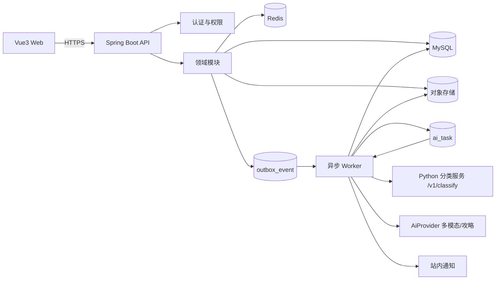

# 摄影师约拍平台 · 后端架构设计 v2.0

> 版本：v2.0 · 2026-11-14（v1.2 已归档至 `归档_旧版稿/后端架构设计_v1.2.md`）
> 依据：`PRD.html` v0.2（功能编号 FR-x.y）、`AI-1_作品智能入库_架构与后端设计.md`、`AI-3_图片分类打标签工作流.md`、`前端架构与内容优化.md`、`src/types.ts`、`src/services/api.ts`、`ai-classifier/`（已实现的分类服务与 SQL）
> 目标：两人团队（Vue3 + Spring Boot + Vite）做出可演示、可答辩、可扩展的后端闭环。**本版不是推翻 v1.2，而是把 v1.2 里"口径不一致 / 说了没给结构 / 与已实现代码对不上"的地方一次性收口。**

## 0. 本版改了什么（v1.2 → v2.0）

| # | v1.2 的问题 | v2.0 的处理 | 影响面 |
|---|---|---|---|
| 1 | 作品域三份文档各写一套：本文 `portfolio_work`/`work_tag(tag_type)`、AI-1 `works`/`work_assets`/`work_tags(dimension)`、`ai_classifier.sql` 又是 `work_tag` | 统一为 `work` / `work_asset` / `work_tag(tag_type)`；AI-1 的叫法降为"历史叫法"，见 §1.3 对照表 | 全部表名、Mapper、迁移脚本 |
| 2 | 作品状态两套：AI-1 七态、本文 `UPLOADED/READY/TAG_FAILED` | 采用 AI-1 七态 + `PENDING_REVIEW` + `MANUAL_RETRY`，并补上"发布前必须 `WAITING_CONFIRM`"的门禁，见 §3.2 | 作品发布、审核、前端状态展示 |
| 3 | 订单"双方标记拍摄完成"含糊；后端 5 态、PRD 4 态、前端 5 个字面量互不对齐 | 定 4 个真状态 + `settled_at` 标记（不是状态），并给前端字面量映射表，见 §3.4.1 / §5.0.4 | 订单接口、前端状态机 |
| 4 | `booking_order` 没有 `work_id`，FR-1.2「约 TA」无处落库（前端 `BookingOrder.workId` 已在用） | 补 `work_id`、`source`、`offer_price`，并定义"谁能写价、何时写死"，见 §3.4.1 | 下单接口、报价/确认 |
| 5 | 返图/成片交付零表零接口，而"修图拖延、拍完失联"是 PRD 点名的核心痛点 | 新增 `booking_delivery`：只留"承诺日/已交付"痕迹，不做倒计时、不计分（PRD §9 已否决返图倒计时），见 §3.4.2 | 订单详情、通知 |
| 6 | 肖像授权两处要求（PRD FR-4.3、AI-1 §7.5），库里零字段 | 新增 `portrait_consent` + `work.portrait_consent`，并给出撤销后的联动，见 §3.6 | 作品发布门禁、合规材料 |
| 7 | 圈子接口写了两条（`/feed`、`/feed/{id}/collect`），表清单里没有任何 feed 表；FR-4.1 是 P0 | 补 `feed_post`/`feed_media`/`feed_collect`/`follow`，并落地"同组图只有一个首源"，见 §3.5 | 圈子、出片回流 |
| 8 | 冷启动存量场照导入只有`source_type` 一个词，没有入口 | 补 `/admin/imports` 接口组与默认 `PRIVATE` 规则，见 §5.5 | 演示数据、合规 |
| 9 | 5 处空头承诺：统一错误码没定义、`audit_log` 提了没表、幂等只有一列、游标只说"由 created_at+id 组成"、Outbox 去重没表（且索引了 `next_retry_at` 字段列表里却没有） | 全部补齐：错误码表 §5.0.2、`audit_log`/`idempotent_record`/`outbox_consumed` §4.2、游标编码 §5.0.3 | 接口、基础设施 |
| 10 | AI 章节与 `ai-classifier` 实际实现脱节：七阶段链里 `SAFETY_CHECK/NORMALIZE/INDEX` 在代码里不存在，`style.onnx` 未训却当成能用，`ai_runs/ai_run_steps` 无实现 | 改成"责任分工表 + HTTP 契约 + 上线门禁"，并取消三表重复记账，见 §6.1/§6.2/§6.5/§6.6 | AI 链路、答辩材料 |
| 11 | `ai_classifier.sql` 不可重复执行、§7 的 3 类锁定又被 §8/§9 覆盖 | 定迁移规范与待修 3 项，见 §4.5 | 建库、CI |
| 12 | 爽约处理、意向金、等级、拼单拆账在 PRD 里明确"待拍板"，本文要么默认处理要么不提 | 全部移入 §12.1 待拍板，只在库表预留字段，不实现、不展示 | 产品边界 |

---

## 1. 设计结论

采用 **Spring Boot 3 + Java 17 的模块化单体**。所有业务先部署为一个应用，代码按领域模块隔离，通过领域事件和异步任务解耦。这样能减少微服务的部署、鉴权、联调成本，同时保留后续拆分 AI、搜索、消息的边界。

### 1.1 本期技术基线

| 层 | 选型 | 用途 |
|---|---|---|
| API | Spring Web MVC、Spring Validation | REST 接口、参数校验、统一异常 |
| 认证 | Spring Security、JWT Access Token + Refresh Token | 登录、鉴权、角色权限 |
| ORM | MyBatis-Plus + XML/注解 SQL | 单表 CRUD、分页；多表显式 JOIN，禁止 N+1 |
| 数据库 | MySQL 8.0 | 业务主数据、状态、审计、任务与事件 |
| 缓存 | Redis 7 | 热点缓存、限流、验证码、位置共享瞬时数据、分布式锁 |
| 异步 | MySQL Outbox + `ai_task` 任务表轮询（MVP）；Redis Stream 作 P1 升级 | 事件投递与 AI 任务，见 §7.6 |
| 文件 | S3 兼容对象存储（MinIO / OSS） | 原图、缩略图、分析图、模型产物 |
| AI | `AiProvider` 适配器 + 已实现的 Python 分类服务（`ai-classifier/pipeline/serve.py`） | 题材/风格/影调标签、检索重排、攻略生成 |
| 文档 | OpenAPI / springdoc | 接口联调和演示 |
| 观测 | Actuator + 结构化日志 + `traceId` 贯穿 | 健康检查、错误定位 |

本期不引入 Kafka、Elasticsearch、独立微服务、向量数据库和支付系统。作品规模达到数十万、并发或团队规模明显增长后，再把搜索与 AI Worker 独立出去。

### 1.2 工程约束（沿用 v1.2，逐条可检查）

- Spring Bean 一律构造器注入；单例 Bean 不保存请求态。
- 连接池先用 Actuator + 慢查询 + `EXPLAIN ANALYZE` 定位，再调 `maximumPoolSize`。
- MyBatis-Plus 只管单表；作品列表、帖子列表、订单时间线禁止循环内逐条查询关联对象。
- 缓存 Cache Aside：先提交库，再删缓存；空值短 TTL + 互斥锁保护热点 Key。
- 消息消费必须可重复执行；失败抛异常触发重试，禁止 `catch` 后吞掉。
- AI 输出只能提供候选或解释，**不能直接改订单、可见性、价格和权限**。

### 1.3 命名与口径公约（本版新增，冲突时以本节为准）

**1.3.1 文档权威顺序**：`PRD.html` v0.2 ＞ 本文 v2.0 ＞ `AI-1` / `AI-3` 文档 ＞ 前端文档。任何文档间冲突，按此顺序裁决，并把裁决记进本文 §0。

**1.3.2 表名规范**：单数、小写下划线、不用保留字。`user` 改名 `app_user` —— MySQL 8 官方手册明确不建议把表命名为 `user`（与权限语义混淆、RENAME 受限），同时避免与 Spring Security 的 `User` 类撞名。

**1.3.3 与 AI-1 的术语对照**（AI-1 的叫法不再出现在代码里）：

| AI-1 文档 | 本文 / 库表 | 说明 |
|---|---|---|
| `works` | `work` | 作品主表 |
| `work_assets` | `work_asset` | 文件资产 |
| `work_ai_results` | `work_ai_result` | 模型原始与归一化结果 |
| `work_tags` | `work_tag` | 与 `ai_classifier.sql` 一致 |
| `work_tags.dimension` | `work_tag.tag_type` | 同一概念，`tag_type` 已在迁移脚本中落地 |
| `ai_tasks` | `ai_task` | 单数统一 |

**1.3.4 标签维度编码**：只允许 `SUBJECT` / `STYLE` / `TONE` / `LIGHT` / `OUTFIT` / `LOCATION`。AI-1 里的 `CLOTHING` 统一写作 `OUTFIT`；AI-1 里的"场景"维度就是 `SUBJECT`，不另立维度。

**1.3.5 文档编号冲突**：PRD §4 的 `AI-3` 是「AI 风格预演」，仓库里的 `AI-3_图片分类打标签工作流.md` 是分类工作流 —— 两者撞号。分类工作流文档自本版起引用时写全文件名（内部代号 `PF-3`），**聊天与答辩中不得只说"AI-3"**。

**1.3.6 字段命名**：数据库 `snake_case`，JSON `camelCase`，由 MapStruct/Jackson 统一转换；**不允许接口层直接透出数据库字段名**。

**1.3.7 ID 精度**：主键是 BIGINT 雪花 ID，JSON 必须序列化为**字符串**。前端 `src/types.ts` 里所有 `id: string`，JS 的 `Number` 只有 2^53 精度，直接输出 Long 会在前端静默错位。

**1.3.8 时间**：数据库存 UTC `DATETIME`；接口出入参统一 ISO-8601 带偏移（`2026-11-21T14:00:00+08:00`）；前端 `date`/`time` 两个字段自行拆分显示，后端不为展示拆分字段。

**1.3.9 枚举两套写法的理由**：数据库存大写 `SNAKE`（便于排查与迁移），**对外 API 使用前端已有的小写字面量**（`pending` / `requirement` / `paid-companion` …）。前端类型已固化且成本更高，由后端做转换层，见 §5.0.4。

---

## 2. 总体架构



分类服务是**内部依赖**，不进公网、不持有数据库权限，只做"图 → 结构化标签"，其余全部由 Spring Boot 承担（§6.2）。

### 2.1 分层与包结构

- `interfaces` 只处理 HTTP、DTO、鉴权、参数校验，不直接访问 Mapper。
- `application` 编排用例、事务、权限检查、状态机推进。
- `domain` 保存实体、状态机、领域规则，不依赖 Web 与具体 AI SDK。
- `infrastructure` 实现 Mapper、Redis、对象存储、AI 客户端、事件发布。
- 跨模块只调用对方的 Application Service 或发布事件，不读对方表。

```text
com.photo.platform
├─ interfaces                 # controller、request、response、converter（枚举与 ID 序列化）
├─ application                # 用例服务、事务、事件处理、状态机
├─ domain
│  ├─ user                    # 账号、摄影师资料、屏蔽
│  ├─ portfolio               # 作品、资产、标签、肖像授权
│  ├─ classify                # 分类服务客户端、标签字典、模型注册
│  ├─ marketplace             # 需求帖、档期帖、搭子帖、报名
│  ├─ booking                 # 订单、状态机、交付承诺、位置共享、互评
│  ├─ social                  # 圈子、收藏、关注
│  ├─ conversation            # 会话、消息
│  ├─ notification            # 站内通知
│  └─ moderation              # 审核、举报、申诉、审计
├─ infrastructure             # mysql、redis、oss、ai、security、scheduler
└─ shared                     # ID、分页游标、错误码、审计、事件
```

### 2.2 模块依赖白名单（新增）

| 模块 | 允许依赖 | 禁止 |
|---|---|---|
| `portfolio` | `user`（读公开资料）、`moderation`（送审） | 直接读 `booking_order` |
| `booking` | `portfolio`（校验 work 可见性）、`marketplace`（校验帖子）、`conversation`（建会话）、`notification` | 直接改 `work.status` |
| `marketplace` | `user`、`booking`（发「接单」事件） | 直接建订单（必须走 booking 用例） |
| `social` | `portfolio`（出片回流引用 work）、`moderation` | 直接改 `work` 媒体 |
| `moderation` | 无业务依赖 | 被任何人绕过写状态 |
| `classify` | `portfolio`（只接收 workId 与对象 key） | 直接改 `work.status`、直接写 `work_tag`（必须经 portfolio 的 NORMALIZE） |

---

## 3. 核心领域模型

### 3.1 用户与摄影师

一个账号可同时是客户、摄影师、摄影爱好者，**不建互斥角色**。`photographer_profile` 是供给侧扩展资料。

- `app_user`：账号、昵称、头像、手机号/邮箱、状态、锁版本、最近登录。
- `photographer_profile`：简介、城市、可服务区域、设备、**接单开关**、作品数缓存。
- `user_tag`：用户自选标签（用于"风格相近"的粗召回，不参与权重）。
- `user_block`：屏蔽关系，查询与发消息时统一拦截（**在 SQL 层过滤，不靠前端隐藏**）。

### 3.2 作品与 AI 标签（状态机本版收敛）

`work` 存元数据，文件在对象存储。AI 结果必须可追溯，避免重复调用导致标签漂移。

```text
DRAFT → UPLOADING → PROCESSING → WAITING_CONFIRM → PUBLISHED → HIDDEN
                        │              │              └→ PENDING_REVIEW → PUBLISHED / REJECTED
                        └→ FAILED → PROCESSING（重试 ≤3）→ MANUAL_RETRY
WAITING_CONFIRM → DRAFT（摄影师退回修改）
```

| 当前状态 | 事件 | 目标状态 | 守卫条件 |
|---|---|---|---|
| `DRAFT` | 创建上传会话 | `UPLOADING` | 已登录且是本人 |
| `UPLOADING` | 确认上传完成 | `PROCESSING` | ≥1 个资产通过大小/魔数/MIME 校验；幂等键命中则直接返回原 workId |
| `PROCESSING` | 全阶段成功 | `WAITING_CONFIRM` | 标签已 NORMALIZE 落库 |
| `PROCESSING` | 阶段失败 | `FAILED` | 记 `error_code`（脱敏） |
| `FAILED` | 用户点重试 | `PROCESSING` | `attempts < 3` |
| `FAILED` | 超过重试上限 | `MANUAL_RETRY` | 进人工队列 |
| `WAITING_CONFIRM` | 发布 | `PUBLISHED` | **发布门禁 4 条**：≥1 张有效图、`place_id` 已确认、≥1 个 STYLE 或 OUTFIT 标签、`portrait_consent` 已勾选 |
| `WAITING_CONFIRM` | 退回 | `DRAFT` | 本人 |
| `PUBLISHED` | 摄影师下架 / 授权被撤销 | `HIDDEN` | — |
| `PUBLISHED` | 命中审核规则 | `PENDING_REVIEW` | 审核项不删数据 |
| `PENDING_REVIEW` | 审核通过 / 驳回 | `PUBLISHED` / `REJECTED` | 写 `audit_log` |

**硬规则**

1. 只有 `PUBLISHED` 的作品进公开作品流、地点筛选和 AI-2 候选集。
2. `canBook`（前端 `WorkCard.canBook`）= `work.status=PUBLISHED` ∧ 摄影师 `accepting_orders=1` ∧ 双方无屏蔽。
3. `WAITING_CONFIRM` 是**发布门禁**，不是可选步骤 —— v1.2 的"AI 成功即 READY"会跳过地点确认与肖像授权，必须去掉。
4. 标签双写：`work_tag` 存规范化标签（可筛选），`work_ai_result` 存模型原始 JSON（仅审计与重新归一化，前端只读归一化结果）。

### 3.3 帖子

`market_post` 统一承载三类帖子，`post_type` = `DEMAND` / `AVAILABILITY` / `COMPANION`；公共字段统一，类型差异放扩展表。

| 扩展表 | 承载 |
|---|---|
| `demand_post` | 场景描述、期望时间、预算区间、`groupable`、`party_size` |
| `availability_post` | 可接人数、可约时段、价格说明 |
| `companion_post` | `companion_mode`（`PAID` 顺路带拍 / `PURE` 纯搭子）、人数上限、已报人数、报名截止 |
| `post_media` | 帖子图片或作品引用 |

帖子状态：`DRAFT → PUBLISHED → LOCKED`（人满或到期）`→ COMPLETED`（成行收尾）；旁支 `EXPIRED` / `CANCELLED`。`COMPLETED` 只有搭子帖会用到，需求帖/档期帖到期即 `EXPIRED`。

**多人拼单（FR-1.3）不需要独立表**：PRD 的口径是"凑好后推一人代表整单发一条帖"，代表已由 `author_id` 承载，只需 `demand_post.groupable` + `party_size` 备注。自动拆账/多人分别报名属于 PRD §8 待拍板项，不建表（§12.1）。

### 3.4 订单、交付与轻安全

`booking_order` 是唯一约拍事实源，**不使用"帖子是否已接单"表达订单状态**。

#### 3.4.1 状态机（4 个真状态 + 1 个标记）

```text
PENDING_CONFIRMATION ──摄影师报价 ──▶ PENDING_CONFIRMATION（写 offer_price，状态不变）
PENDING_CONFIRMATION ──客户确认──▶ CONFIRMED（final_price = offer_price，价格从此写死）
PENDING_CONFIRMATION / CONFIRMED ──任一方在 start_at 前取消──▶ CANCELLED
CONFIRMED ──任一方标记拍摄完成──▶ COMPLETED（写 completed_by / completed_at，开启 7 天互评窗口）
COMPLETED ──客户标记已结清──▶ COMPLETED + settled_at（标记，不是状态）
```

| 规则 | 说明 |
|---|---|
| 价格只能由两个接口写 | 摄影师报价接口写 `offer_price`；客户确认接口写 `final_price`。两者不相等 → `PRICE_MISMATCH` 冲突 |
| 价格写死后要改 | 产生 `PRICE_CHANGE` 事件，订单回到 `PENDING_CONFIRMATION`，双方重新确认 |
| 谁标记完成 | 任一方标记即 `COMPLETED`（平台不经手钱，该状态只用于解锁互评与留痕）。对方不认可时不改状态，走举报留痕 |
| 乐观锁 | 所有状态更新 `where id=? and status=? and version=?`，失败重读后重试 1 次，再失败返回 `CONFLICT_VERSION` |
| 审计 | 每次状态变化写 `booking_status_log`（操作者、前后状态、幂等键、`trace_id`） |
| 结清 | `settled_at` / `settled_by` 由客户写，摄影师可见；**不做支付、不做分账** |
| 拉起来源 | `source` = `WORK`（作品页约 TA）/ `POST`（帖子接单）/ `PROFILE`（主页约 TA），对应 PRD FR-1.2 / FR-2.1 |

#### 3.4.2 返图与成片交付（`booking_delivery`）

PRD §1.2 点名的痛点是"修图拖延、拍完失联"，但 PRD §9 又明确否决"返图倒计时、约定书、信用分"。因此：

- 只记录**承诺**与**事实**：`promised_at`（摄影师确认时自己填的返图日，可空）、`delivered_at`、`status`（`PROMISED` / `DELIVERED` / `CANCELLED`）、`asset_count`。
- 逾期由 `promised_at` **动态计算**，不写库、不展示倒计时、不进任何评分或排名，只发一次站内提醒。
- 交付物放对象存储，客户通过短时签名 URL 查看；下架与授权撤销同样作用于交付物。

#### 3.4.3 轻安全三件套（PRD §5.2）

| 能力 | 落点 |
|---|---|
| 平台内沟通 | 订单 `CONFIRMED` 时自动建 `conversation`（`biz_type=BOOKING`），双方为成员；交易相关沟通留痕 |
| 行程互见 | `CONFIRMED` 后双方可见 `start_at`、`location_text`、昵称、头像；其余人不可见 |
| 实时位置共享 | **默认关**；仅订单双方、仅拍摄时段（`start_at ±2h`）内可开；坐标只进 Redis（TTL 60s，心跳续期），库中只存开关与时段（`booking_location_share`）；不进 feed、不进日志、任务结束自动失效 |

#### 3.4.4 爽约（只预留，不实现）

`booking_order` 预留 `cancel_reason`（`USER_CANCEL` / `NO_SHOW` / `WEATHER` / `OTHER`）与 `no_show_user_id`。是否在主页互见（PRD §5.3 方案 b）**尚未拍板**，本版只写字段、不做展示、不做统计页（§12.1）。

#### 3.4.5 互评

`review`：`booking_id`、`from_user_id`、`to_user_id`、`tags_json`（PRD §5.2 固定标签集）、`content`（可空）、`visible_at`。

- 提交窗口：`completed_at` + 7 天（`review_deadline_at` 写在订单上）。
- 可见规则：**双方都提交立即互相可见**；只有一方提交则窗口到期后才可见。这条必须在 `review` 写入与查询两处同时实现，不能只靠前端。
- 唯一约束 `(booking_id, from_user_id)`；不打分，只点标签（避免信用体系，符合 PRD §9）。

### 3.5 圈子与出片回流

| 表 | 关键字段 | 规则 |
|---|---|---|
| `feed_post` | `author_id`、`type`（`SCENE` 场照 / `WORK_BACKFLOW` 出片回流）、`work_id` 可空、`origin_feed_post_id` 可空、`city_code`、`place_id`、`status`、`created_at` | 排序 = 新 + 近地（`created_at`、`city_code` 命中加权），**无粉丝权重** |
| `feed_media` | `feed_post_id`、`object_key`、`sort_no` | 媒体只在首源落库，转发不复制 |
| `feed_collect` | `user_id`、`feed_post_id` | 收藏即"我想要这种"，可反哺撮合（P1） |
| `follow` | `follower_id`、`followee_id` | 只做流过滤，不做权重 |

**首源规则（PRD FR-4.3）**：同一组图只有一个首发源 —— 摄影师默认发并 @ 客户；客户要发自己修过的版本就"转发到自己主页"，`origin_feed_post_id` 指回首源，`feed_media` 复用，不重复上传、不做两套内容。

### 3.6 治理：肖像授权、审核、举报

- `portrait_consent`：`work_id`、`granted_by`、`subject_user_id` 可空、`scope`（`PUBLIC` / `ORDER_ONLY`）、`anonymize`（不打标签、不 @）、`granted_at`、`revoked_at`。
  - 含可识别人脸的作品发布前必须勾选"已获客户同意"，否则 `WORK_CONSENT_REQUIRED`。
  - 客户要求匿名或下架时：撤销授权 → `work.visibility=PRIVATE` + `work.status=HIDDEN` + 下架对应 `feed_post` + 通知摄影师，全过程写 `audit_log`。
- `moderation_record`：`target_type` / `target_id` / `provider`（`RULE` / `AI` / `MANUAL`）/ `result` / `reason` / `status` / `reviewer_id` / `appeal_status` / `appealed_at`。
  - 命中违规 → `PENDING_REVIEW`，**不物理删除**，保留申诉。
- `audit_log`：`actor_id`、`actor_role`、`action`、`target_type`、`target_id`、`before_json`、`after_json`、`ip_hash`、`request_id`、`created_at`。举报、下架、审核、授权撤销、管理员改数据全写这里。

---

## 4. 数据库设计

### 4.1 公共约定

- 主键 `BIGINT` 雪花 ID（MyBatis-Plus `ASSIGN_ID`），接口序列化为字符串（§1.3.7）。
- 金额 `DECIMAL(10,2)` + `currency`（本期固定 `CNY`）；不使用浮点。
- 时间 UTC `DATETIME`；`start_at`/`end_at` 成对出现并校验 `end_at > start_at`。
- 业务表统一 `created_at`、`updated_at`、`deleted_at`（软删）；需要归属的表带 `created_by`。
- 枚举在 Java 定义，库内存大写字符串（§1.3.9）。
- 字符集 `utf8mb4` / `utf8mb4_0900_ai_ci`；所有外键列建索引（不建物理外键，靠应用层保证）。

### 4.2 表清单（按模块分组）

**A. 账号**

| 表 | 关键字段 | 约束/索引 |
|---|---|---|
| `app_user` | `phone`、`email`、`nickname`、`avatar_key`、`status`、`token_version`、`last_login_at` | `uk_phone`、`uk_email`、`idx_status` |
| `photographer_profile` | `user_id`、`bio`、`city_code`、`service_radius`、`devices_json`、`accepting_orders` | `uk_user`、`idx_city_accepting` |
| `user_tag` | `user_id`、`tag_code` | `uk_user_tag` |
| `user_block` | `user_id`、`blocked_user_id` | `uk_block` |

**B. 作品、标签与授权**

| 表 | 关键字段 | 约束/索引 |
|---|---|---|
| `work` | `photographer_id`、`title`、`description`、`status`、`visibility`、`source_type`、`location_text`、`place_id`、`lat`/`lng`（模糊到城市级）、`city_code`、`captured_at`、`ai_version`、`portrait_consent`、`published_at`、`version` | `idx_owner_status`、`idx_city_status_time`、`uk_dedup`（`photographer_id`,`sha256` 落在 asset 上） |
| `work_asset` | `work_id`、`photographer_id`（为去重冗余）、`object_key`、`thumb_key`、`mime_type`、`width`、`height`、`file_size`、`sha256`、`perceptual_hash`、`sort_no` | `uk_photo_sha`（`photographer_id`,`sha256`）、`idx_work_sort` |
| `work_tag` | `work_id`、`tag_type`、`tag_code`、`confidence`、`source`（`AI`/`RULE`/`USER`/`IMPORT`）、`model_version`、`is_confirmed` | `uk_work_tag`（`work_id`,`tag_type`,`tag_code`）、`idx_tag_lookup`（`tag_code`,`confidence`,`work_id`） |
| `work_ai_result` | `work_id`、`task_id`、`schema_version`、`raw_json`、`normalized_json`、`model_key`、`model_version`、`overall_confidence` | `idx_work` |
| `portrait_consent` | `work_id`、`granted_by`、`subject_user_id`、`scope`、`anonymize`、`granted_at`、`revoked_at` | `idx_work`、`idx_subject` |
| `place` | `name`、`city_code`、`adcode`、`lng`、`lat`、`parent_id`、`source` | `uk_city_name`、`idx_parent` |

**C. AI 资产（已由 `ai-classifier/sql/ai_classify.sql` 建表，本文只引用）**

| 表 | 用途 |
|---|---|
| `label_dictionary` | 标签唯一真源：`tag_type`、`tag_code`、`name_cn`、`prompt_en`、`definition`、`negative_hint`、`enabled` |
| `ai_model_registry` | 模型版本：`model_key`、`version`、`task`、`artifact_key`、`labels_key`、`metrics_json`、`threshold_json`、`traffic_ratio`、`status` |
| `classify_sample` | 训练样本池：`photographer_id`（**必须**，按摄影师分组切分）、`split`、`quality`、`content_hash`、`license_note` |
| `classify_prediction_log` | 推理日志：置信度、`color_json`、`is_corrected`、`fallback`，用于阈值调优与主动学习 |

**D. 任务与事件**

| 表 | 关键字段 | 约束/索引 |
|---|---|---|
| `ai_task` | `task_type`、`biz_type`、`biz_id`、`stage`、`input_version`、`status`、`attempts`、`max_attempts`、`worker_id`、`lease_expire_at`、`next_retry_at`、`error_code`、`error_message`、`provider`、`model_version`、`prompt_version`、`input_hash`、`trace_id`、`latency_ms`、`token_usage`、`fallback_reason` | `uk_task`（`biz_type`,`biz_id`,`stage`,`input_version`）、`idx_claim`（`status`,`next_retry_at`） |
| `outbox_event` | `event_id`、`event_type`、`aggregate_type`、`aggregate_id`、`payload`、`status`、`retry_count`、`next_retry_at`、`last_error`、`published_at` | `uk_event_id`、`idx_status_retry`（`status`,`next_retry_at`） |
| `outbox_consumed` | `event_id`、`consumer_name`、`consumed_at` | `uk_consumed`（`event_id`,`consumer_name`） |

**E. 帖子与搭子**

| 表 | 关键字段 | 约束/索引 |
|---|---|---|
| `market_post` | `author_id`、`post_type`、`status`、`city_code`、`place_id`、`start_at`、`end_at`、`title` | `idx_type_status_city_time`（`post_type`,`status`,`city_code`,`start_at`,`id`） |
| `demand_post` | `post_id`、`scene_text`、`budget_min`、`budget_max`、`groupable`、`party_size` | `uk_post` |
| `availability_post` | `post_id`、`available_slots`、`price_note` | `uk_post` |
| `companion_post` | `post_id`、`companion_mode`、`capacity`、`joined_count`、`deadline_at` | `uk_post`、`idx_mode_status_deadline` |
| `post_media` | `post_id`、`object_key`、`work_id` 可空、`sort_no` | `idx_post` |
| `companion_application` | `post_id`、`applicant_id`、`status`、`message` | `uk_post_applicant`、`idx_applicant` |
| `companion_group` | `post_id`、`conversation_id`、`locked_at`、`capacity` | `idx_post` |

**F. 订单**

| 表 | 关键字段 | 约束/索引 |
|---|---|---|
| `booking_order` | `work_id`、`post_id`、`source`、`customer_id`、`photographer_id`、`start_at`、`end_at`、`location_text`、`place_id`、`offer_price`、`final_price`、`currency`、`status`、`version`、`confirmed_at`、`completed_by`、`completed_at`、`review_deadline_at`、`settled_by`、`settled_at`、`cancel_reason`、`cancelled_by`、`no_show_user_id` | `idx_customer_status`、`idx_photographer_time`（`photographer_id`,`status`,`start_at`,`end_at`,`id`）、`idx_start_at` |
| `booking_status_log` | `booking_id`、`from_status`、`to_status`、`actor_id`、`idempotency_key`、`trace_id` | `idx_booking_time`、`idx_idem` |
| `booking_delivery` | `booking_id`、`promised_at`、`delivered_at`、`status`、`asset_count`、`note` | `uk_booking` |
| `booking_location_share` | `booking_id`、`user_id`、`sharing`、`enabled_at`、`expires_at`、`last_point_at` | `uk_booking_user` |
| `review` | `booking_id`、`from_user_id`、`to_user_id`、`tags_json`、`content`、`visible_at` | `uk_booking_from`、`idx_to_time` |

**G. 社交与消息**

| 表 | 关键字段 | 约束/索引 |
|---|---|---|
| `feed_post` | `author_id`、`type`、`work_id`、`origin_feed_post_id`、`city_code`、`place_id`、`content`、`status`、`created_at` | `idx_status_city_time`（`status`,`city_code`,`created_at`,`id`） |
| `feed_media` | `feed_post_id`、`object_key`、`sort_no` | `idx_feed` |
| `feed_collect` | `user_id`、`feed_post_id` | `uk_collect` |
| `follow` | `follower_id`、`followee_id` | `uk_follow` |
| `conversation` | `biz_type`（`BOOKING`/`COMPANION`）、`biz_id`、`status` | `uk_biz`（`biz_type`,`biz_id`） |
| `conversation_member` | `conversation_id`、`user_id`、`last_read_message_id` | `uk_member` |
| `message` | `conversation_id`、`sender_id`、`content`、`client_msg_id` | `idx_conv_time`、`uk_client_msg`（`conversation_id`,`sender_id`,`client_msg_id`） |
| `notification` | `user_id`、`type`、`biz_type`、`biz_id`、`read_at` | `idx_unread`（`user_id`,`read_at`,`created_at`,`id`） |

**H. 治理与基础设施**

| 表 | 关键字段 | 约束/索引 |
|---|---|---|
| `moderation_record` | `target_type`、`target_id`、`provider`、`result`、`reason`、`status`、`reviewer_id`、`appeal_status`、`appealed_at` | `idx_target`、`idx_status` |
| `audit_log` | `actor_id`、`actor_role`、`action`、`target_type`、`target_id`、`before_json`、`after_json`、`ip_hash`、`request_id` | `idx_target`、`idx_actor_time` |
| `idempotent_record` | `user_id`、`idempotency_key`、`method`、`path`、`request_hash`、`status`、`response_code`、`response_body`、`expires_at` | `uk_idem`（`user_id`,`idempotency_key`）、`idx_expire` |

### 4.3 作品筛选索引（MVP 不建向量库）

1. SQL 先按 `work.status=PUBLISHED`、`city_code`/`place_id`、`captured_at`、作者 `accepting_orders` 过滤。
2. `work_tag` 按 `STYLE`/`OUTFIT` 做标签召回；`TONE`（规则产出）只进综合分与展示，**不做硬过滤**，否则会把一半作品挡在门外。
3. 应用层算综合分取 Top 20，再按需交 AI 重排或直接展示。

```text
score = 0.45 * tag_match
      + 0.25 * scene_match      # SUBJECT 命中
      + 0.20 * location_match
      + 0.10 * availability_match
```

同一摄影师最多占 3 个位置；没有作品或 AI 失败时降级为"地点 + 时间筛人"（PRD FR-1.1 冷启动规则）。

### 4.4 索引与 SQL 规则

索引顺序：等值条件 → 范围条件 → 排序字段。核心初始索引：

```sql
CREATE INDEX idx_work_city_status_time ON work (city_code, status, captured_at, id);
CREATE INDEX idx_work_tag_lookup       ON work_tag (tag_code, confidence, work_id);
CREATE INDEX idx_post_type_city_time   ON market_post (post_type, status, city_code, start_at, id);
CREATE INDEX idx_booking_photographer  ON booking_order (photographer_id, status, start_at, end_at, id);
CREATE INDEX idx_notification_unread   ON notification (user_id, read_at, created_at, id);
```

- 列表接口只取页面需要的列，禁止 `SELECT *`；补作者信息用一次 `JOIN` 或批量 `IN`。
- 每条手写 SQL 自查 `deleted_at IS NULL` —— 逻辑删除插件不会改写手写 SQL。
- 分页一律游标（§5.0.3）；只有后台小数据量允许 `page`/`pageSize`，上限 50。

### 4.5 迁移规范与待修项（新增）

**规范**

1. 用 Flyway，命名 `V{n}__{desc}.sql`：`V1__init.sql`（业务表+索引）→ `V2__ai_classify.sql`（字典/模型注册/样本/预测日志）→ `V3__seed_demo.sql`（演示数据）。
2. 每个脚本必须**可重复执行**（`CREATE TABLE IF NOT EXISTS`、`ADD COLUMN` 前判断列存在、`INSERT ... ON DUPLICATE KEY UPDATE`），CI 会连续跑两遍。
3. **一处改动，两处同步**：增删 `tag_code` 必须同时改 `label_dictionary` 与模型侧 `models/<task>.labels.json`；`labels.json` 的顺序就是 ONNX 输出顺序，**禁止手工编辑**。
4. 模型版本切换与数据库迁移不同批发布（AI-1 §10 已有要求）。

**`ai-classifier/sql/ai_classify.sql` 待修 3 项**（本版不改该文件，列入 §14 交付物）

| # | 问题 | 修法 |
|---|---|---|
| 1 | `CREATE TABLE` 无 `IF NOT EXISTS`，二次执行直接报错 | 全部加 `IF NOT EXISTS` |
| 2 | `ALTER TABLE work_tag ADD COLUMN` 不可重入 | 改为 `information_schema` 判存在后再 `EXECUTE`，或并入 `V1__init.sql` |
| 3 | §7 把题材锁成 3 类（`PORTRAIT`/`CONVENTION`/`OTHER`），又被 §8 覆盖成 8 类 | 删掉 §7 的锁定语句，只保留 §8/§9 的终态定义 |

---

## 5. REST API 设计

### 5.0 通用约定

**5.0.1 响应信封**（前端 `src/services/api.ts` 的 `request()` 取 `payload.data ?? payload`，此形状直接可用）：

```json
{ "code": "OK", "message": "success", "data": {}, "requestId": "01J..." }
```

**5.0.2 错误码表**（v1.2 只写了"统一错误码"，这里给出可枚举的清单）

| 错误码 | HTTP | 触发场景 | 前端可做的下一步 |
|---|---|---|---|
| `AUTH_UNAUTHORIZED` | 401 | 未登录 / token 缺失 | 跳登录 |
| `AUTH_TOKEN_EXPIRED` | 401 | access token 过期 | 静默 refresh 后重放一次 |
| `AUTH_FORBIDDEN` | 403 | 越权访问他人资源 | 提示无权限，不重试 |
| `AUTH_CODE_INVALID` | 400 | 验证码错误/过期 | 重发验证码 |
| `RATE_LIMITED` | 429 | 触发限流 | 按 `Retry-After` 等待 |
| `VALIDATION_FAILED` | 400 | 参数校验失败（含游标非法） | 高亮字段 |
| `RESOURCE_NOT_FOUND` | 404 | 资源不存在或已软删 | 返回列表 |
| `CONFLICT_VERSION` | 409 | 乐观锁失败 | 重读最新状态再操作 |
| `IDEMPOTENCY_KEY_REUSED` | 409 | 同一 key 不同请求体 | 换 key |
| `IDEMPOTENCY_IN_PROGRESS` | 409 | 首次请求仍在执行 | 稍后重试同一 key |
| `UPLOAD_TOO_LARGE` | 413 | >20MB | 压缩后重传 |
| `UPLOAD_MIME_REJECTED` | 415 | 非 JPEG/PNG/WebP 或魔数不符 | 换文件 |
| `WORK_NOT_OWNED` | 403 | 非本人作品 | — |
| `WORK_STATE_INVALID` | 409 | 状态不允许该动作（如未确认就发布） | 刷新作品状态 |
| `WORK_LOCATION_UNCONFIRMED` | 422 | 发布时地点未确认 | 引导确认地点 |
| `WORK_CONSENT_REQUIRED` | 422 | 含人脸但未勾选授权 | 弹出授权勾选 |
| `WORK_DUPLICATE` | 200 | 同摄影师同 `sha256` 已存在 | 直接复用返回的 `workId` |
| `BOOKING_STATE_INVALID` | 409 | 订单状态不允许该动作 | 刷新订单 |
| `BOOKING_TIME_CONFLICT` | 409 | 摄影师该时段已被占 | 推荐相近时段 |
| `PRICE_MISMATCH` | 409 | `final_price ≠ offer_price` | 重新确认价格 |
| `REVIEW_WINDOW_CLOSED` | 409 | 超过 7 天窗口 | 置灰入口 |
| `REVIEW_ALREADY_SUBMITTED` | 409 | 重复提交互评 | 显示已提交 |
| `POST_NOT_AVAILABLE` | 409 | 帖子已锁定/过期 | 返回集市 |
| `POST_CAPACITY_FULL` | 409 | 搭子人数已满 | 提示人满 |
| `AI_DEGRADED` | 200 | AI 不可用但已降级返回（**不是错误**） | 显示"按规则结果"标签 |
| `MODERATION_PENDING` | 423 | 内容审核中 | 提示等待 |
| `INTERNAL_ERROR` | 500 | 未预期异常 | 展示 `requestId` 便于排查 |
| `DEPENDENCY_TIMEOUT` | 504 | 分类服务/对象存储超时 | 提示稍后重试 |

**5.0.3 游标分页**：请求 `cursor`、`pageSize`（≤50）；响应 `items`、`nextCursor`、`hasMore`。

- 游标 = `BASE64URL({"t":<created_at 毫秒>,"i":"<id 字符串>"})`，排序键 `(created_at, id)` 降序，翻页条件 `(created_at, id) < (?, ?)`。
- `cursor` 为空表示首页；解析失败返回 `VALIDATION_FAILED`，**不允许**退化成 `OFFSET`。
- 后台列表用 `page`/`pageSize`，与公开列表分开。

**5.0.4 枚举映射表**（库内大写 ↔ API 小写，前端已固化小写）：

| 域 | 数据库 | API |
|---|---|---|
| 订单状态 | `PENDING_CONFIRMATION` | `pending` |
| | `CONFIRMED` | `confirmed` |
| | `COMPLETED` | `shooting-done` |
| | `COMPLETED` + `settled_at≠null` | `settled` |
| | `CANCELLED` | `cancelled` |
| 帖子类型 | `DEMAND` | `requirement` |
| | `AVAILABILITY` | `availability` |
| | `COMPANION` | `companion` |
| 搭子关系 | `PAID` | `paid-companion` |
| | `PURE` | `pure-companion` |

**5.0.5 状态与动作由后端下发**：`OrderStatus` 类响应必须同时返回 `status`、`statusLabel`（中文）与 `allowedActions`（如 `["cancel","confirm"]`）。前端文档 §5.2 明确"按钮由后端可执行动作决定"，且禁止页面自行拼中文状态。

**5.0.6 幂等**：所有写接口接受 `Idempotency-Key`。服务端在 `idempotent_record` 落 `(user_id, key)`，`request_hash` 不同 → `IDEMPOTENCY_KEY_REUSED`；同 key 同体 → 直接返回首次响应副本。TTL 24 小时，定时清理。

### 5.1 认证

| 方法 | 路径 | 说明 |
|---|---|---|
| POST | `/auth/send-code` | 发送登录验证码（开发环境固定演示码） |
| POST | `/auth/login` | 登录，返回 `accessToken`/`refreshToken` |
| POST | `/auth/refresh` | 刷新 access token |
| POST | `/auth/logout` | 撤销 refresh token（`token_version++`） |
| GET | `/me` | 当前用户资料（含角色组合） |
| PUT | `/me` | 更新昵称、头像、地区、标签 |

### 5.2 作品与 AI

| 方法 | 路径 | 说明 |
|---|---|---|
| POST | `/works/upload-sessions` | 创建上传会话（批量，返回 `sessionId` + 每项的 `assetId`/`uploadUrl`/`expiresIn`） |
| POST | `/works/upload-sessions/{id}/complete` | 确认上传并创建作品，返回 `workId` + `status=PROCESSING`；必须带 `Idempotency-Key` |
| GET | `/works/{id}` | 作品详情 + 标签 + 作者 + `canBook`（前端 `getWork` 已调用） |
| GET | `/works` 或 `POST /ai/work-search` | 作品筛选（见 §6.4） |
| GET | `/works/{id}/ingestion` | 入库进度、失败原因、待确认标签 |
| PATCH | `/works/{id}/tags` | 替换式保存用户确认后的标签与地点 |
| POST | `/works/{id}/publish` | 发布（执行 §3.2 四条发布门禁） |
| POST | `/works/{id}/ingestion/retry` | 仅本人、仅 `FAILED`/`MANUAL_RETRY` |
| GET | `/photographers/{id}` | 摄影师主页（前端 `getPhotographer` 已调用） |
| GET | `/photographers/{id}/works` | 摄影师作品集（**只返回 `PUBLISHED`**） |
| GET | `/ai/tasks/{id}` | AI 任务状态与阶段 |
| POST | `/ai/style-preview` | 参考图 + 用户照片的风格预演（P1） |
| POST | `/ai/guide` | 拍摄攻略（P1，由 `generateGuide` 提供，v1.2 有方法无路由） |

`POST /ai/work-search` 的请求/响应形状直接对齐前端：

```json
// 请求 { "location": "西安小寨", "scene": "周六出古风角色，要夜景灯笼感", "shootAt": "2026-11-21T14:00:00+08:00" }
// 响应 { "items": [ /* WorkCard 形状 */ ], "aiUsed": true, "degraded": false, "traceId": "..." }
```

服务端**不信任客户端传来的作者 ID**，自己按地点/标签/档期召回，并在每项给 `matchReason`（"命中：夜景、灯笼、古风；周六在小寨附近有档期"）。

### 5.3 帖子、订单、搭子、交付

| 方法 | 路径 | 说明 |
|---|---|---|
| POST | `/posts` | 创建需求帖/档期帖/搭子帖（`kind` 用小写字面量） |
| GET | `/posts` | 公开列表（游标；前端 `getMarketPosts` 已调用） |
| GET | `/posts/{id}` | 帖子详情 |
| POST | `/posts/{id}/applications` | 报名搭子帖（FR-5.2：**发起人挑选，不是先到先得**） |
| POST | `/posts/{id}/applications/{appId}/accept` | 发起人选定报名者 |
| POST | `/posts/{id}/lock` | 锁定帖子（人满或到期），生成 `companion_group` 与临时会话 |
| POST | `/bookings` | 从作品/帖子/主页创建订单；请求含 `workId`、`startAt`、`locationText`；带 `Idempotency-Key`（前端 `createBooking` 已调用） |
| POST | `/bookings/{id}/offer` | 摄影师报价，写 `offer_price` |
| POST | `/bookings/{id}/confirm` | 客户确认，写 `final_price`（必须等于 `offer_price`） |
| POST | `/bookings/{id}/cancel` | 任一方在 `start_at` 前取消，写 `cancel_reason` |
| POST | `/bookings/{id}/complete` | 任一方标记拍摄完成，写 `completed_by` |
| POST | `/bookings/{id}/settle` | 客户标记线下已结清 |
| PUT | `/bookings/{id}/delivery` | 摄影师填交付承诺日/标记已交付 |
| POST | `/bookings/{id}/location-share` | 位置共享开关（仅拍摄时段，默认关） |
| POST | `/bookings/{id}/reviews` | 提交互评标签（7 天窗口，唯一一次） |
| GET | `/bookings` | 我的订单列表（游标；前端 `getOrders` 已调用） |
| GET | `/bookings/{id}/timeline` | 状态流转 + 审计时间线 |

创建订单必须校验：未被对方屏蔽、摄影师 `accepting_orders=1`、该时段无冲突（含 `end_at` 重叠检测）、地点字段完整、帖子仍可用（若来自帖子）、幂等键未使用。

### 5.4 圈子、消息、通知

| 方法 | 路径 | 说明 |
|---|---|---|
| POST | `/feed/posts` | 发布场照或出片回流（指向 `work_id` 或 `origin_feed_post_id`） |
| GET | `/feed` | 新 + 近地排序，游标分页 |
| POST | `/feed/{id}/collect` | 收藏 / 取消收藏 |
| POST | `/conversations` | 按订单或搭子成行创建会话（已存在则返回原会话） |
| GET | `/conversations` | 我的会话列表 |
| GET | `/conversations/{id}/messages` | 历史消息（游标，`after` 参数支持轮询） |
| POST | `/conversations/{id}/messages` | 发消息（`clientMsgId` 幂等） |
| GET | `/notifications` | 站内通知（未读优先） |
| POST | `/notifications/read-all` | 全部已读 |

本期消息用短轮询（3 秒）足够演示；WebSocket 属 P1，且消息落库逻辑必须与推送解耦。

### 5.5 管理端（新增）

| 方法 | 路径 | 说明 |
|---|---|---|
| POST | `/admin/imports` | 创建冷启动导入会话（`sourceType=COLD_START_IMPORT`），必须填摄影师归属、来源说明、地点、授权状态 |
| POST | `/admin/imports/{id}/complete` | 批量确认导入；未确认授权的图默认 `PRIVATE`，不进公开流 |
| POST | `/admin/works/{id}/review` | 审核通过/驳回（写 `moderation_record` + `audit_log`） |
| POST | `/admin/reports` / `/admin/reports/{id}/resolve` | 举报登记与处置 |
| POST | `/admin/appeals/{id}/resolve` | 申诉处理 |
| POST | `/admin/models/{key}/traffic` | 模型灰度比例调整（写 `ai_model_registry`，禁止改类别） |

管理端接口一律要求 `ADMIN` 权限，且所有写操作强制写 `audit_log`。

### 5.6 与前端已对齐的接口清单（实证）

`src/services/api.ts` 现在直接调用以下 6 个接口，后端必须按此形状实现，否则演示会掉进 mock 分支：

| 前端调用 | 路径 | 形状要求 |
|---|---|---|
| `getWorks` | `POST /ai/work-search` | `{items, aiUsed, degraded}` |
| `getWork` | `GET /works/{id}` | 单对象，字段同 `WorkCard` |
| `getPhotographer` | `GET /photographers/{id}` | 单对象，字段同 `Photographer` |
| `getMarketPosts` | `GET /posts?cursor=&pageSize=50` | `{items}` |
| `getOrders` | `GET /bookings?cursor=&pageSize=50` | `{items}` |
| `createBooking` | `POST /bookings` | 请求 `{workId, date, time}` → 响应 `{id, status}` |

注意：`createBooking` 现在传的是 `date` + `time` 两个字段。**后端应兼容这两种入参**：优先 `startAt`（ISO-8601），缺失时用 `date`+`time` 按 `Asia/Shanghai` 拼装；响应统一返回 `startAt`，前端自行拆分显示。

---

## 6. AI 服务设计

### 6.0 结论：AI 是"受控的异步能力层"

业务用例不直接调模型。AI 层拆两个边界：

```text
业务应用层
  └─ AiApplicationService（建任务、查状态、触发重试）
       ├─ 控制面：任务状态、预算、幂等、审计、模型路由
       └─ 执行面：Worker（阶段编排、NORMALIZE、写库、发事件）
            ├─ Guardrail：输入/输出校验、超时、步数上限、白名单工具
            ├─ ClassifierClient → Python 分类服务（题材/风格/TONE）
            ├─ AiProvider → 多模态/攻略模型（地点、服装、光线、文案）
            └─ 结果归一化与证据写回
```

能解决的三个风险：上传接口不被模型延迟拖住；模型失败只重跑当前阶段；模型输出不会直接改订单、地点或公开状态。

白名单工具只有三个：`search_works`、`resolve_place`、`load_work_context`。单任务最多 4 步、总时长 6 秒，超限直接转规则结果。简单查询不强制 RAG。

### 6.1 适配器与分类服务契约（本版按已实现代码写死）

```java
public interface AiProvider {
    WorkTagResult tagWork(ImageRef image, TagContext context);          // → 分类服务 + 多模态补地点/服装/光线
    SearchRewriteResult rewriteSearch(SearchQuery query);
    List<WorkCandidate> rerank(SearchQuery query, List<WorkCandidate> candidates);
    GuideResult generateGuide(GuideQuery query);
}
```

`MockAiProvider` 与真实适配器并存，比赛现场可一键切 Mock（`mock.ai.enabled`）。

**Python 分类服务（`ai-classifier/pipeline/serve.py`，uvicorn，默认 8100）现状**

| 项 | 内容 |
|---|---|
| 入口 | `POST /v1/classify`（multipart `file`，或 form `imageBase64`；>24MB 返 413）、`POST /v1/classify-base64`、`POST /v1/embed`、`GET /v1/health`、`GET /v1/models` |
| 出参 | `{subject[], style[], tone[], color{24 维}, modelVersion{}, fallback, latencyMs}`；条目 `{code, confidence, aboveThreshold}`（零样本条目无 `aboveThreshold`） |
| 鉴权 | **无**。因此只允许内网/同 Pod 访问，绝不打公网，也不给它数据库凭据 |
| 并发 | 无 batch 接口 → 组图在 Worker 侧并发度 ≤4，逐张调用 |
| 超时 | 后端读超时 8 秒；失败只重试 1 次（分类是幂等纯函数，重试安全） |

后端只上送**长边 1536 的分析图**（服务内部再缩到 CLIP 的 224 并算 24 维色彩），不上送原图。

### 6.2 阶段链与责任分工（替换 v1.2 的"七阶段全在 Worker"）

| 阶段 | 归属 | 现状 | 本版决定 |
|---|---|---|---|
| `PREPROCESS` | 后端 + 分类服务 | 服务侧 `build_inputs`（EXIF→RGB→224→512+24 维）已实现 | 后端只负责生成 1536 长边 webp 与缩略图 |
| `SAFETY_CHECK` | 后端 | **无实现** | MVP 只做 MIME/魔数/尺寸/像素上限 + 人工审核队列；不接第三方鉴黄（成本与合规都不划算） |
| `CLASSIFY` | 分类服务 | `classify_heads` / `classify_zero_shot` 已实现 | 题材、风格、TONE 全部来自这一步 |
| `TAG` | 后端 | **无实现** | 多模态只补地点/服装/光线/描述，**不得输出题材与风格**（避免与分类头打架） |
| `NORMALIZE` | 后端 | **无实现** | 字典校验 + 按类阈值 + 三档置信 + `work_tag` 落库（§6.3） |
| `EMBED` | 分类服务 `/v1/embed` | 已实现，未接入 | P1 才接；MVP 不建向量索引 |
| `INDEX` | 后端 | **无实现** | MVP 用 `work_tag` 召回，不建向量库 |

这张表是答辩口径：**已经有的写"已实现"，没有的写"本版决定不做/降级"**，不再出现"链上写着但代码里没有"的阶段。

### 6.3 标签空间、阈值与落库规则

**标签空间**（`labels/dictionary.json` 与 `label_dictionary` 必须一致）

| 维度 | 启用数 | 编码 |
|---|---|---|
| `SUBJECT` | 8 | `STUDIO`、`OUTDOOR`、`CONVENTION`、`STREET_PORTRAIT`、`INTERIOR_PORTRAIT`、`ARCHITECTURE`、`LANDSCAPE`、`STILL_FOOD` |
| `STYLE` | 13 | `BLUE_TONE`、`INS`、`JAPANESE`、`KOREAN`、`WESTERN`、`CINEMATIC`、`FRESH`、`FILM`、`DARK_MOOD`、`MONO`、`HK_RETRO`、`CYBER`、`VINTAGE` |
| `TONE` | 9 | 规则产出，不训练：`TONE_WARM`/`COOL`/`HIGH_SAT`/`LOW_SAT`/`HIGH_CONTRAST`/`LOW_CONTRAST`/`HIGH_KEY`/`LOW_KEY`/`LIFTED_BLACK` |
| `LIGHT` / `OUTFIT` | 6 / 6 | 只登记、不训练；**`work_tag` 不接受这两维的 `AI` 来源标签**，只接受 `USER` 手标 |

**多标签**：两个头都是 `multi=true`（sigmoid）。所以 `work_tag` 一行一个标签，同一 `work` 可同时命中多个 `STYLE`（日系 + 清新天然共存）。唯一键 `(work_id, tag_type, tag_code)` 保证不重复。

**阈值三层，各管一段**

| 层 | 取值 | 作用 |
|---|---|---|
| 模型按类阈值 | `models/<task>.threshold.json`（验证集 P≥0.8 的最小阈，0.30~0.95 步长 0.05，无正样本给 0.55），并登记到 `ai_model_registry.threshold_json` | 决定 `aboveThreshold` |
| 服务全局下限 | `MIN_CONF`（env，默认 0.30） | 决定"返不返回这一条" |
| 业务三档（AI-1 §6.3，**以此为准**） | ≥0.75 建议标签；0.50–0.74 待确认；<0.50 不展示 | 决定 `work_tag.confidence` 与是否参与强匹配 |

**落库规则**

1. `aboveThreshold=true` 且 `confidence ≥ 0.50` → 写 `work_tag`，`source=AI`，`is_confirmed=0`。
2. `0.50–0.74` 的标签可写库但**不参与 AI-2 召回权重**，前端显示为"待确认"。
3. `< 0.50` 只进 `work_ai_result.raw_json`，不写 `work_tag`。
4. `TONE` → `source=RULE`、`confidence=1.0000`，不参与训练。
5. 地点标签必须由摄影师确认后写 `location_text` + `place_id`；AI 推断的地点只能是低置信候选（`MODEL_GUESS` 不允许升级为已确认地点）。

### 6.4 AI 筛作品主流程

1. `FAST` 模型/解析器把自然语言转成受控 `SearchQuery`：`placeId`、`timeRange`、`styleCodes`、`subjectCodes`、`needsConfirmation`；地点必须映射到 `place_id`，不允许模型自由扩展地理范围。
2. SQL + `work_tag` 召回 ≤200 个公开作品，按 §4.3 规则分取 Top 40，结果带 `sourceIds` 与命中字段。
3. 候选足够且请求复杂时才让 `QUALITY` 模型把 Top 40 重排为 Top 20，并给每项 `matchReason`；模型不得新增候选、改标签、突破屏蔽/可见性过滤。
4. 超时 / JSON 校验失败 / 熔断 / 预算耗尽 → 直接返回规则排序；接口总超时 6 秒，模型子调用预算 3 秒。
5. 响应带 `aiUsed`、`degraded`、`traceId`；不返回内部提示词与思维过程。

### 6.5 模型上线门禁（新增，答辩必须能说清）

| 能力 | 依赖 | 当前状态 | 未达标时的降级 |
|---|---|---|---|
| 题材召回（8 类） | `subject.onnx` | ⚠ 只训了非人像 3 类（`ARCHITECTURE`/`LANDSCAPE`/`STILL_FOOD`），val macroF1 0.9881、test 1.0（train504/val85/test83，按 `photographer_id` 分组），同划分零样本 0.7732 | **人像作品禁止写入 `SUBJECT` 标签**（否则人像会被硬塞成 `STILL_FOOD`，实测置信度 0.998）；人像作品只保留 `STYLE`/`TONE`/`USER` 标签 |
| 风格召回（13 类） | `style.onnx` | ✗ 未训练；且 `_run` 只在两个头都返回空时才走零样本，**缺 `style.onnx` 时 `style` 恒为 `[]`**，README 说的"风格零样本兜底"实际不成立 | 风格维度整体标记 `UNAVAILABLE`（不是"无风格"）；AI-2 不用风格做召回，改由摄影师手标 `work_tag(source=USER)` 兜底；演示时明确说明 |
| 训练数据 | `labels.csv` + 外部数据集 | 672 条，`photographer_id` 仅 `mx_01~mx_08`（8 组），`style` 全为 `INS` 占位 | 风格头不能开训；外部数据集中许可未声明的那批**上线前必须替换** |

**发布前自检**：`GET /v1/models` 返回的 `version`、`labels`、`thresholds` 必须与 `ai_model_registry.status=ONLINE` 那版一致，否则拒绝启动 Worker（防止"灰度改了但服务没重启"）。

### 6.6 记账：三张表，不做重复记账

v1.2 同时要 `ai_task`、`ai_runs`、`ai_run_steps`，再加分类服务自己的 `classify_prediction_log` —— 四处口径必然对不上。本版只保留：

| 表 | 记账粒度 | 谁写 |
|---|---|---|
| `ai_task` | 每个 `biz + stage + input_version` 一条，含租约、重试、错误码、耗时、`trace_id` | 后端 Worker |
| `work_ai_result` | 每次模型调用的原始与归一化结果 | 后端 Worker（NORMALIZE 之后） |
| `classify_prediction_log` | 分类专用：置信度、`color_json`、`is_corrected`、`fallback` | 分类服务或后端回调 |

`ai_run_step` 属 P1（要做"多步 Agent 工具调用"时才有意义），本期不建。日志中**不写**原图 URL、手机号、精确地址、完整提示词。

---

## 7. 一致性、并发与异步

### 7.1 事务边界

- 下单、报价、确认、取消、完成、结清、互评均为单库事务。
- 上传与业务写入两步：库只存对象 key，不存二进制。
- 领域事件走 Outbox，业务事务提交后再异步处理，避免"订单成功但通知丢失"。

### 7.2 幂等与并发

- 所有写接口支持 `Idempotency-Key`（落 `idempotent_record`）。
- 订单状态更新：`where id=? and status=? and version=?`。
- 摄影师时段冲突：应用层预校验 + 数据库唯一约束兜底（同摄影师同 `start_at` 不可重复）。
- 消息：`(conversation_id, sender_id, client_msg_id)` 唯一。
- Redis 限流：验证码 1 分钟 1 次、登录 10 次/分钟、发帖 20 次/小时、消息 30 条/分钟、上传 10 次/分钟、AI 筛选 30 次/分钟。

### 7.3 Outbox 与去重

事件：`WORK_UPLOADED`、`WORK_READY`、`WORK_PUBLISHED`、`POST_PUBLISHED`、`POST_LOCKED`、`BOOKING_CONFIRMED`、`BOOKING_COMPLETED`、`BOOKING_DELIVERED`、`REVIEW_SUBMITTED`、`REVIEW_VISIBLE`、`PORTRAIT_CONSENT_REVOKED`、`MODERATION_PENDING`。

- 发布：`outbox_event` 写 `status=PENDING`，轮询器抢占（`SKIP LOCKED`）→ 投递 → 置 `PUBLISHED`；失败累加 `retry_count` 与 `next_retry_at`，超上限 `DEAD` + 告警。
- 消费：先查 `outbox_consumed(event_id, consumer_name)`，有则跳过，无则处理并在**同一事务**内写去重记录。**消费失败必须抛异常**，禁止吞掉。

### 7.4 缓存策略

Key 前缀 `photo:{module}:{resource}:{id}`：

```text
photo:work:detail:{id}
photo:photographer:profile:{userId}
photo:place:dict:{version}
photo:search:works:{sha256(query)}
photo:geo:booking:{bookingId}:{userId}     # 位置共享瞬时点，TTL 60s
```

- 不存在的作品写 `__NULL__`，TTL 60 秒，防 ID 穿透。
- 热点回填用 `SETNX` 互斥锁，锁必须有 TTL 并在 `finally` 释放。
- TTL 加 0~5 分钟随机扰动，避免批量同时过期。
- 更新遵循"先写库、再删缓存"；删缓存失败落 Outbox 重试，仍失败告警。
- Redis 只存可丢失数据；订单、AI 任务、Outbox 以 MySQL 为事实源。

### 7.5 事务代理

带 `@Transactional` 的方法必须经 Spring 代理调用；同类 `this.confirm()` 不会生效。状态变更 + 写日志 + 写 Outbox 在同一事务内；通知、缩略图、AI 任务在提交后异步。

### 7.6 队列分级（本版新增，降低两人团队实现风险）

| 阶段 | 方案 | 理由 |
|---|---|---|
| MVP | `ai_task` 表 + `SELECT ... FOR UPDATE SKIP LOCKED` 轮询（1 秒） | 少一个中间件、可观测、可手工重放；比赛演示完全够 |
| P1 | Redis Stream Consumer Group | 吞吐与延迟上去后再换；`Producer`/`Consumer` 接口不变，业务代码不用改 |

无论哪档，任务表都是最终事实源；`@Scheduled` 只做补偿扫描，且必须带租约或 ShedLock，多实例下不得裸跑。

---

## 8. 安全、隐私与内容治理

- 验证码只存哈希与过期时间；`token_version` 支持一键下线。
- JWT 只带 `userId`、`tokenVersion`、权限摘要，不放敏感资料。
- 对象存储：私有桶 + 短时签名 URL（原图/成片 10 分钟，缩略图可长缓存）。
- 客户端直传：`/works/upload-sessions` 只给一次性签名、对象 key、大小上限、允许 MIME；确认时**重新**校验大小、扩展名、Content-Type 与图片魔数，再异步生成缩略图。
- EXIF 清理：去掉 GPS 精确坐标、设备序列号；公开作品的坐标只到城市级。
- 位置共享见 §3.4.3：默认关、限时段、只进 Redis（TTL 60s）、不进日志与 feed。
- 分类服务无鉴权 → 只绑内网，不打公网，不给数据库凭据；模型产物（`.onnx`）只走签名 URL 下载。
- 手机号、精确地址、聊天内容、位置按最小权限返回，日志脱敏。
- 帖子、图片、昵称进审核队列；命中违规设 `PENDING_REVIEW`，不物理删除，保留申诉与审计。
- 举报、屏蔽、下架是管理员接口，全部写 `audit_log`。
- 冷启动导入的历史场照：未确认授权默认 `PRIVATE`，且必须在 `classify_sample.license_note` 留来源记录（比赛材料要用）。

---

## 9. 部署与环境

### 9.1 最小部署

```text
Nginx
  └─ Spring Boot 容器
       ├─ MySQL 8
       ├─ Redis 7
       ├─ MinIO / OSS
       └─ Python 分类服务（uvicorn pipeline.serve:app，仅内网）
```

开发环境用 Docker Compose 起 MySQL、Redis、MinIO、分类服务。生产/比赛环境至少配置每日数据库备份、对象存储生命周期规则和健康检查。

环境变量（放部署平台，不提交仓库）：

```text
DB_URL / DB_USERNAME / DB_PASSWORD
REDIS_URL
OSS_ENDPOINT / OSS_BUCKET / OSS_ACCESS_KEY / OSS_SECRET_KEY
JWT_SECRET / JWT_ACCESS_TTL / JWT_REFRESH_TTL
AI_PROVIDER / AI_API_KEY / AI_TIMEOUT_MS
CLASSIFIER_BASE_URL / CLASSIFIER_TIMEOUT_MS / CLASSIFIER_MIN_CONF
MOCK_AI_ENABLED
```

### 9.2 观测指标

- API：请求量、P95、5xx、慢 SQL、限流触发数。
- 业务：作品 AI 成功率、待确认转发布率、筛选命中率、订单确认率、取消率、互评完成率、交付承诺按期率。
- AI：分类服务 P50/P95、`fallback` 比例、`aboveThreshold` 通过率、**`style` 恒定为空告警**、人工修正率（`is_corrected`）。
- 异步：Outbox 积压、`ai_task` 重试数、`MANUAL_RETRY` 数、死信数。

### 9.3 性能预算与调优顺序

| 链路 | 目标 | 调优顺序 |
|---|---:|---|
| 普通读接口 | P95 < 300 ms | SQL 投影与索引 → 缓存 → 连接池 |
| 发帖、下单、确认 | P95 < 500 ms | 缩短事务 → 乐观锁重试 → 异步通知 |
| AI 筛作品 | P95 < 3 s，硬超时 6 s | 规则召回 → query 缓存 → 重排降级 |
| 单图分类 | P95 < 800 ms | 分析图缩到 1536 → 并发 ≤4 → 超时降级 |
| 图片上传确认 | P95 < 500 ms | 直传对象存储 → 异步缩略图与标签 |
| 异步任务 | 失败可重试 | 租约 → 退避（1/5/30 分钟）→ 死信/人工重试 |

连接池初始 10~20、连接超时 30 秒、空闲超时 30 秒，再按活跃连接与 DB CPU 调。排查闭环固定为"慢日志 → `EXPLAIN ANALYZE` → 改 SQL/索引 → 复测"；出现 `type=ALL`、扫描行数远大于返回行数、临时表或 filesort 时先修 SQL，不先用缓存掩盖。

Nginx 对 JSON/JS/CSS/HTML 开 Gzip，图片视频不重复压缩，启用 `sendfile` 与 keep-alive；大文件只走签名 URL 直传直下，不经 Spring Boot 内存中转。

---

## 10. 开发排期（对齐 PRD §7 的优先级）

| 阶段 | 内容 | 出口条件 | 对应 FR |
|---|---|---|---|
| 1 主链路 | 登录、资料、作品上传与详情、三类帖子、订单状态机、圈子信息流 | 演示数据能走完"发帖 → 接单 → 确认 → 完成" | FR-1.2/1.3/2.1/2.2/2.3/5.1 |
| 2 AI 接入 | 分类服务接入、NORMALIZE、AI 筛作品、规则降级、导入脚本 | 输入场景 3 秒出作品；分类服务挂掉仍能按地点时间筛人 | FR-1.1、AI-1/AI-2 |
| 3 协作与安全 | 搭子报名与成行会话、通知、互评、屏蔽举报、位置共享、审计、交付承诺 | 搭子帖走通"报名 → 挑选 → 锁定 → 群聊" | FR-3.1/4.3/5.2/6.1/6.2 |
| 4 演示打磨 | OpenAPI、Mock AI 开关、种子数据、错误态、压测、备份演练 | 验收清单 §13 全绿 | 全部 |

PRD §7 里排第 5/6/7 的 AI 风格预演、拍摄攻略、搭子撮合属 P1：**只在主链路绿了之后做，且必须是"有降级路径"的降级实现**。

---

## 11. PRD 功能覆盖矩阵（新增）

| 编号 | 优先级 | 后端落点 | 状态承载 | 本版变化 |
|---|---|---|---|---|
| FR-1.1 AI 筛作品 | P0 | `POST /ai/work-search` + `work_tag` 召回 + 规则降级 | 请求态，无持久状态 | 明确降级协议与 `degraded` |
| FR-1.2 刷作品约 TA | P0 | `POST /bookings`（`source=WORK`） | `booking_order` | **补 `work_id`** |
| FR-1.3 发需求帖 | P1 | `market_post`+`demand_post` | 帖子状态机 | 明确拼单不建表 |
| FR-1.4 看档期帖急约 | P1 | `market_post` + 时间窗查询 | 帖子状态机 | 明确"当天"用 `start_at` 范围 |
| FR-2.1 接单 | P0 | `POST /bookings/{id}/offer` | `offer_price` | 定义报价接口 |
| FR-2.2 发档期帖 | P1 | `market_post`+`availability_post` | 帖子状态机 | — |
| FR-2.3 发搭子帖 | P1 | `companion_post` | 帖子状态机 | — |
| FR-3.1 搭子三件套 | P1 | `companion_post` + `companion_application` + `companion_group` | `PAID`/`PURE` | 明确"发起人挑选" |
| FR-4.1 同好圈子 | P0 | `feed_post`/`feed_media`/`feed_collect`/`follow` | 审核态 | **补 4 张表**（v1.2 只有接口） |
| FR-4.2 拍摄集市 | P1 | `market_post` 三类聚合 | 帖子状态机 | — |
| FR-4.3 出片回流 | P1 | `feed_post.origin_feed_post_id` + `portrait_consent` | 首源规则 | **补首源与授权撤销联动** |
| FR-5.1 约拍流程 | P0 | `booking_order` + `booking_status_log` | 4 态 + `settled_at` | 状态机收敛、补报价与结清 |
| FR-5.2 搭子流程 | P1 | `companion_application`/`companion_group`/`conversation` | 帖子 → 订单外状态 | 明确独立于约拍状态 |
| FR-6.1 平台内沟通 | P1 | `conversation`/`message` | 会话状态 | 补"确认即建会话" |
| FR-6.2 站内通知 | P1 | `notification` + Outbox 消费者 | 读态 | 补事件清单 |
| AI-1 作品智能入库 | P0 | `work`/`work_asset`/`work_tag`/`ai_task` | 作品 7 态 | 与分类服务对齐 |
| AI-2 作品筛选 | P0 | `POST /ai/work-search` | — | 补门禁与降级 |
| AI-3 风格预演 | P1 | `POST /ai/style-preview` + `ai_task` | 任务态 | 标注 P1、需降级 |
| AI-4 拍摄攻略 | P1 | `POST /ai/guide` | 无状态（可缓存） | **补路由**（v1.2 只有方法） |
| AI-5 搭子撮合 | P1 | 帖子召回 + `user_tag` | — | 标注 P1 |
| AI-6 档期助手 | P2 | 不做 | — | 明确不做 |
| AI-7 互评画像摘要 | P2 | 不做（`review.tags_json` 已存，将来可直接算） | — | 明确不做 |

---

## 12. 明确不做，与待你拍板的 5 件事

### 12.1 明确不做（与 PRD §9 边界一致）

- 平台代收款、意向金、退款、分账、对账。
- 重型信用分、摄影师等级定级（PRD §6 已降为待定）、排行榜。
- 粉丝权重推荐、复杂社交关系图谱。
- 多人拼单的自动拆账。
- Kafka、Elasticsearch、向量数据库、独立微服务、多地域部署。
- 返图倒计时、约定书、违约金（PRD §9 明确否决）。

### 12.2 待你拍板（本版只预留字段，不做实现，不做 UI）

| # | 待定项 | 涉及位置 | 一旦拍板的改动量 |
|---|---|---|---|
| 1 | 爽约处理走 a（不处理）/ b（主页互见一条记录）/ c（意向金） | `booking_order.cancel_reason`、`no_show_user_id` 已预留；b 需加一个只读查询，c 需要推翻 §9「平台不经手钱」 | b 很小；c 很大（要重做支付/退款/风控） |
| 2 | 意向金是否引入 | 同上 | 同上 |
| 3 | 摄影师等级 L1–L5 是否做 | 需新增定级规则与证据链 | 中（无规则无法写代码） |
| 4 | 多人拼单是否做自动拆账 | `demand_post.groupable`、`party_size` 已预留 | 大（订单要支持一对多） |
| 5 | 搭子临时群聊的功能范围 | `conversation`/`message` 已支持多成员 | 小到中（看是否要语音/图片/公告） |

按上下文交接包的约定：**这五项由你决定，我不替你定**。定之前只保留字段与占位注释，不写任何默认行为。

---

## 13. 验收标准

**主链路**

1. 新用户可登录、上传作品，看到 AI 标签或人工降级标签，并在 `WAITING_CONFIRM` 确认地点与授权后发布。
2. 输入地点、时间、场景后 3 秒内返回候选作品；分类服务不可用时仍能按地点 + 时间返回，且响应 `degraded=true`。
3. 从作品或帖子创建订单 → 摄影师报价 → 客户确认（价格写死）→ 标记完成 → 结清，全链路有 `booking_status_log` 可追溯。
4. 搭子帖可发布、报名、发起人挑选、锁定并生成临时会话。
5. 拍摄完成后 7 天内双方互评，双方都提交后立即互见；作品可回流圈子，客户可撤销授权并要求下架。
6. 重复提交、越权访问、冲突接单、AI 超时、对象存储失败均有 §5.0.2 的明确错误码与可恢复路径。

**本版新增（可直接判定的工程项）**

7. **口径一致**：代码与迁移脚本里搜索 `portfolio_work` / `work_tags` / `addWorkTag(dimension)` 应为 0 命中（本文 §0、§1.3 的对照表除外，那里是"历史叫法"的记账）；实体、Mapper、SQL 中的表名与 §1.3 一致。
8. **契约可跑**：`src/services/api.ts` 的 6 个调用在后端打通后不再进 mock 分支（用浏览器 Network 面板逐条核对）。
9. **迁移可重入**：`flyway migrate` 连续执行两遍无报错；`V2__ai_classify.sql` 覆盖原 `ai_classify.sql` 的终态（8 类题材 / 13 类风格 / TONE 9 类）。
10. **模型门禁**：`GET /v1/models` 与 `ai_model_registry(status=ONLINE)` 一致；缺 `style.onnx` 时 `work_tag` 不出现 AI 来源的 `STYLE` 标签，前端不展示"无风格"。
11. **ID 与时间**：作品 ID 在浏览器里是字符串且末几位不丢；接口时间带 `+08:00` 偏移，库里是 UTC。
12. **性能**：50 并发压测演示数据，普通读接口 P95 < 300 ms；AI 筛作品在模型不可用时 1 秒内返回规则结果；慢 SQL、缓存命中率、异步积压可在 Actuator 或日志查看。

---

## 14. 第一批交付物

- `backend/` Spring Boot 工程骨架（模块边界照 §2.1，依赖白名单照 §2.2）。
- `db/migration/V1__init.sql`：§4.2 A/B/E/F/G/H 全部表与 §4.4 索引。
- `db/migration/V2__ai_classify.sql`：由 `ai-classifier/sql/ai_classify.sql` 改写为**可重入**版本，并修掉 §4.5 的 3 项。
- `db/migration/V3__seed_demo.sql`：作品、摄影师、地点、订单演示数据。
- `openapi.yaml`：§5 全量，错误码用 §5.0.2 的枚举。
- `docker-compose.yml`：MySQL 8 + Redis 7 + MinIO + 分类服务。
- `scripts/verify-contract.ts`：按 §5.6 逐条打前端真实调用的接口，失败即红。
- 一份《主链路演示脚本》：从说场景 → 筛作品 → 亮作者 → 报价 → 确认 → 完成 → 互评走通，并含"分类服务挂掉"的降级演示。

**已知待修（不影响本版设计，但要进 backlog）**

1. `ai-classifier/sql/ai_classify.sql` 可重入改造（§4.5）。
2. `ai-classifier` 缺 `style.onnx` 时的 `style=[]` 静默降级，建议在服务侧显式返回 `styleUnavailable=true`，避免后端把它当成"这张图没有风格"。
3. `README` / `TRAIN_HANDOVER` 里"风格走零样本兜底"的表述与代码不一致，需同步改。
4. AI-1 文档的表名与维度叫法按 §1.3 改口，或在文首加一句"已由 v2.0 统一"。
